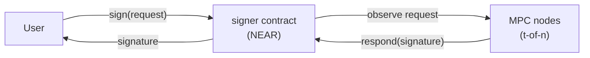

# NEAR MPC

The threshold signature network behind [Chain Signatures](https://docs.near.org/chain-abstraction/chain-signatures) — signatures produced jointly by *t*-of-*n* nodes running in TEEs, with no single party ever holding the complete key.

## What it does

- **Signing** — signs arbitrary payloads under keys derived per caller and derivation path, so a single NEAR account can control any number of keys without any of them ever existing in full. Supports [ECDSA](crates/threshold-signatures/docs/ecdsa/ot_based_ecdsa/intro.md) (Secp256k1) and [EdDSA](crates/threshold-signatures/docs/eddsa/signing.md) (Ed25519).
- **[Confidential Key Derivation](crates/threshold-signatures/docs/confidential_key_derivation/confidential-key-derivation.md)** — derives application-specific keys without revealing the master secret (BLS12-381).
- **[Read RPC](docs/archive/design/foreign-chain-transactions.md)** — nodes independently verify transactions on foreign chains (Ethereum, Solana, Aptos, …) and threshold-sign the observed values, letting NEAR contracts react to external chain events without a trusted relayer. Known under the working name *foreign chain transaction verification* in the code.

## How it works

A signature request is a call to the signer contract (`v1.signer` on mainnet); the nodes pick it up, sign jointly over P2P, and respond on chain. Nodes run inside trusted execution environments (TEEs) and attest what they run on chain; see the [TEE design doc](docs/design/securing-mpc-with-tee/securing-mpc-with-tee.md).

## Where to go next

- **Building on the network?** Start with the [Chain Signatures documentation](https://docs.near.org/chain-abstraction/chain-signatures); the [`near-mpc-sdk`](crates/near-mpc-sdk) crate provides request builders and response verification.
- **Operating a node?** Check the [node requirements](docs/guide/node-requirements.md) and the [operating guide](docs/guide/operating-an-mpc-node.md); the rest of [`docs/guide/`](docs/guide) covers TEE setups, metrics, and migrations.
- **Developing this code?** [Building and testing](docs/development/building-and-testing.md) gets you from checkout to green checks; [`docs/development/`](docs/development) has the rest, including the [engineering standards](docs/development/engineering-standards.md).
- **Contributing?** The [contribution guidelines](CONTRIBUTING.md) describe our issue and PR workflow.
- **Researching security?** We strive to have every feature and critical code path independently audited; the reports live in [`audits/`](audits/README.md). To report a vulnerability, follow the [security policy](.github/SECURITY.md).

## Repository layout

All crates live in a [Cargo workspace](Cargo.toml) under `crates/`. The ones you are most likely to look for:

| Crate | Purpose |
|-------|---------|
| [`mpc-node`](crates/node) | The binary run by MPC participants: NEAR indexer, P2P networking, and the threshold protocols themselves |
| [`mpc-contract`](crates/contract) | The smart contract on NEAR: accepts signature requests, manages the participant set and protocol state, governs upgrades through participant voting |
| [`near-mpc-contract-interface`](crates/near-mpc-contract-interface) | Wire formats accepted by the contract, plus a `client` feature for constructing typed contract calls |
| [`near-mpc-sdk`](crates/near-mpc-sdk) | Logic shared between the MPC contract and its callers |
| [`threshold-signatures`](crates/threshold-signatures) | The threshold cryptography itself |

## Releases

The node and contract ship together as semantically versioned releases; see [RELEASES.md](RELEASES.md) for the process and compatibility guarantees. Docker images build [reproducibly](docs/guide/reproducible-builds.md).

## Get in touch

Questions, feedback, or building something on top? Join the [NEAR Dev Telegram](https://t.me/neardev).
