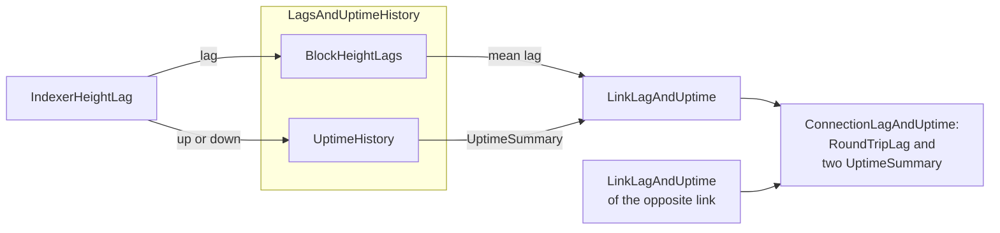

# Lag and Uptime Link Type

This document builds on the [Network Connectivity Tracker](./network-connectivity-tracker.md), which describes the `ConnectivityMonitor` and the traits a link type has to implement.

To make this concrete, in this document, we explore how to convert an `IndexerHeightReport` into link observations, how those observations lead to link measurements and finally, how two link measurements are combined into a single connection status.



## Link observation
An `IndexerHeightReport` reports the reporter's indexer height, as well as the indexer height it has last received from each of its peers.

We can use that to approximate the latency of a link:
```
indexer height lag(A --> B) ~ first_hand_indexer_height(A) - indexer_height of A, as last reported by B
```

```rust
pub enum IndexerHeightLag {
    /// `reporter` lists `peer`: the height `peer` reported to us first-hand, minus the height
    /// `reporter` lists for it. Zero if `reporter` is ahead.
    Present(BlockCount),
    /// `reporter` lists `peer`, but one of the two heights is unknown, so there is no lag.
    Unknown,
    /// `reporter` does not list `peer`.
    Absent,
}

impl IndexerHeightLag {
    fn new(
        first_hand_indexer_height: ReportedIndexerHeight,
        peer_reported_height: Option<ReportedIndexerHeight>,
    ) -> Self {
        let Some(peer_reported) = peer_reported_height else {
            return IndexerHeightLag::Absent;
        };
        match (first_hand_indexer_height, peer_reported) {
            (ReportedIndexerHeight::Unknown, _) => IndexerHeightLag::Unknown,
            (_, ReportedIndexerHeight::Unknown) => IndexerHeightLag::Unknown,
            (
                ReportedIndexerHeight::Known(first_hand),
                ReportedIndexerHeight::Known(peer_reported),
            ) => {
                let count = first_hand
                    .blocks_since(peer_reported)
                    .unwrap_or(BlockCount::new(0));
                IndexerHeightLag::Present(count)
            }
        }
    }
}

```

## Tracking link history

We keep track of a bounded number of observations. The idea is that we use uptime history to model the probability that the link will remain up for a given duration.
We also track block height lags, as even though a link may be up, if it is very slow, it may not be suitable for some computations.

```rust
/// What has been measured about one directed link: how far the heights it carries lag behind, and
/// when it was up.
#[derive(Default)]
pub struct LagsAndUptimeHistory {
    lags: BlockHeightLags,
    uptime_history: UptimeHistory,
}

/// The most recent lags of a link.
#[derive(Default)]
struct BlockHeightLags {
    lags: VecDeque<BlockCount>,
}

/// When a link was up: the last finished up periods and the running one.
#[derive(Default)]
struct UptimeHistory {
    /// How long each finished up period lasted. Each one ended in a disconnect.
    finished_uptimes: VecDeque<Duration>,
    /// `None` while the link is down.
    up_since: Option<Instant>,
}
```

We infer the link status from its history:

```rust

impl ReportLinkStatus for LagsAndUptimeHistory {
    type LinkStatus = LinkLagAndUptime;

    fn link_status(&self) -> LinkLagAndUptime {
        match self.uptime_history.summary() {
            Some(uptime) => LinkLagAndUptime::Up(UpLink {
                mean_lag: self.lags.mean(),
                uptime,
            }),
            None => LinkLagAndUptime::Down,
        }
    }
}

pub enum LinkLagAndUptime {
    /// The last observation was `Absent`.
    Down,
    Up(UpLink),
}

pub struct UpLink {
    /// The mean of the lags in `BlockHeightLags`. Zero while there are none.
    mean_lag: BlockCount,
    uptime: UptimeSummary,
}

/// What a link's `UptimeHistory` adds up to while the link is up.
pub struct UptimeSummary {
    /// When the running up period started.
    up_since: Instant,
    /// Finished up periods in the history, without the shortest. Each one ended in a disconnect.
    disconnects: u32,
    /// The total length of those finished up periods.
    finished_uptime: Duration,
}
```

And finally, we infer the connection status from two link statuses:

```rust
impl InferConnection for LinkLagAndUptime {
    type ConnectionStatus = ConnectionLagAndUptime;

    fn infer_connection(
        a: Option<Self>,
        b: Option<Self>,
    ) -> InferredConnection<ConnectionLagAndUptime> {
        let (Some(Self::Up(a)), Some(Self::Up(b))) = (a, b) else {
            return InferredConnection::NotEstablished;
        };
        match ConnectionLagAndUptime::new(a, b) {
            Some(connection) => InferredConnection::Established(connection),
            None => InferredConnection::NotEstablished,
        }
    }
}

pub struct ConnectionLagAndUptime {
    round_trip_lag: RoundTripLag,
    /// One per link, each judged on its own. Sorted, so that the status does not depend on which
    /// link changed last.
    uptimes: [UptimeSummary; 2],
}

impl ConnectionLagAndUptime {
    /// `None` if the round trip lag of the two links is too high for a connection.
    fn new(a: UpLink, b: UpLink) -> Option<Self> {
        let round_trip_lag = RoundTripLag::new(a.mean_lag, b.mean_lag)?;
        let mut uptimes = [a.uptime, b.uptime];
        uptimes.sort();
        Some(Self {
            round_trip_lag,
            uptimes,
        })
    }
}

#[derive(Clone, Copy, PartialEq, Eq)]
enum RoundTripLag {
    Good,
    /// Above [`AT_RISK_ROUND_TRIP_LAG`]: the connection may be about to break.
    AtRisk,
}

impl RoundTripLag {
    /// `None` above [`MAX_ROUND_TRIP_LAG`]: the connection counts as broken.
    fn new(a: BlockCount, b: BlockCount) -> Option<Self> {
        let round_trip = BlockCount::new(u64::from(a).saturating_add(u64::from(b)));
        if round_trip > MAX_ROUND_TRIP_LAG {
            None
        } else if round_trip > AT_RISK_ROUND_TRIP_LAG {
            Some(Self::AtRisk)
        } else {
            Some(Self::Good)
        }
    }
}
```

Finally, the connection status can be used to make a prediction about whether the connection will live long enough to support a computation of a given duration.
```rust
impl CheckComputationSupport for ConnectionLagAndUptime {
    fn connection_supports(
        &self,
        duration: ComputationDuration,
        now: Instant,
    ) -> ComputationSupported {
        let length = match duration {
            ComputationDuration::Any => return ComputationSupported::Yes,
            // 5 seconds
            ComputationDuration::Seconds => SECONDS_COMPUTATION_LENGTH,
            ComputationDuration::HalfMinute if self.round_trip_lag == RoundTripLag::AtRisk => {
                return ComputationSupported::No;
            }
            // 30 seconds
            ComputationDuration::HalfMinute => HALF_MINUTE_COMPUTATION_LENGTH,
        };
        // The time until the next disconnect of a link is assumed to be exponentially distributed:
        //   disconnect rate              = disconnects / up time
        //   chance to stay up for length = exp(-disconnect rate * length)
        // A link that was never seen to disconnect has a rate of zero, so it is supported at once.
        // One disconnect is free, because `disconnects` leaves out the shortest finished up period:
        // when the protocol state changes, a link may come up with a peer that is still in the
        // previous state, and drop again as soon as that peer follows.
        let stays_up = |uptime: &UptimeSummary| {
            // 0.8
            uptime.disconnect_rate(now).chance_to_stay_up(length) >= REQUIRED_CHANCE_TO_STAY_UP
        };
        if self.uptimes.iter().all(stays_up) {
            ComputationSupported::Yes
        } else {
            ComputationSupported::No
        }
    }
}
```
