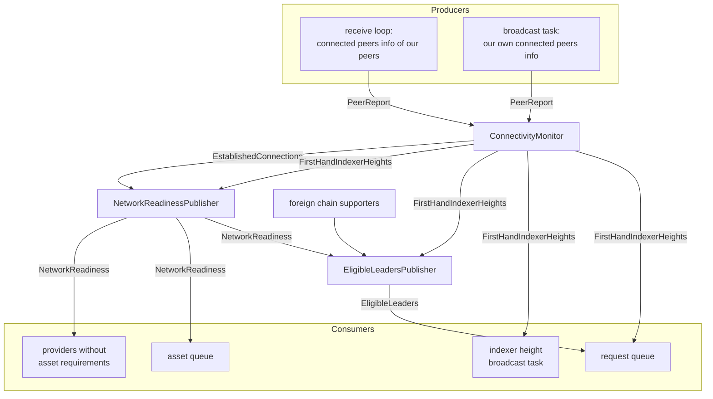

# Network Connectivity Consumers and Publishers

Note: _This doc builds on [Network Connectivity Monitor](./network-connectivity-monitor.md), for motivation, read its [Background](./network-connectivity-monitor.md#background) section._

## Background and Preliminaries

This document explores the consumers, i.e., components that require a view of the network connectivity state (c.f. [Producers](./network-connectivity-monitor.md#peer-reports-and-producers) for the producers).

We assume that the connectivity monitor provides two things:
1. An undirected graph `EstablishedConnections`, which is a current view of all the cluster's connections, as seen by the node holding it.
2. A recent view of `FirstHandIndexerHeights`. These are the block heights the nodes in the cluster have last reported to us as processed.

We recall from [Network Connectivity Monitor](./network-connectivity-monitor.md), that these are the structures the monitor publishes:

```rust
pub struct EstablishedConnections {
    connections: AdjacencyMatrix<ParticipantId, ConnectionLagAndUptime, UndirectedEdge<ParticipantId>>,
}

pub struct FirstHandIndexerHeights {
    heights: NonEmptyBTreeMap<ParticipantId, ReportedIndexerHeight>,
}
```

We further recall that the connection status `ConnectionLagAndUptime` can make qualitative statements about a connection:
```rust
impl ConnectionLagAndUptime {
    /// can be used to estimate whether a connection is sufficient for a specific computation duration
    pub fn connection_supports(
        &self,
        duration: ComputationDuration,
        now: Instant,
    ) -> ComputationSupported;
}

pub enum ComputationSupported {
    Yes,
    No,
}

// to be refined. Triples need about 23 seconds, signatures about 2 seconds.
pub enum ComputationDuration {
    Any,
    Seconds,
    HalfMinute,
}
```

This allows the struct `EstablishedConnections` to return all connections that are insufficient for supporting a given computation. In a healthy network, the set of insufficient connections is always much smaller than the set of sufficient connections.
```rust
impl EstablishedConnections {
    /// For each of `durations`, every pair of nodes that cannot currently run a computation of
    /// that duration together: their connection is not established, or does not support it.
    pub fn connections_not_supporting(
        &self,
        durations: &BTreeSet<ComputationDuration>,
        now: Instant,
    ) -> BTreeMap<ComputationDuration, BTreeSet<UndirectedEdge<ParticipantId>>> {..};
}
```
We refer the reader to [Network Connectivity Link Observations](./network-connectivity-link-observations.md), for the definition of the connection status and the link observation.

## Consumers

We have four consumers:
- the **indexer height broadcast task**: it wants to know:
    - the latest known block heights that were reported by our live peers
```rust
pub trait ReadFirstHandIndexerHeights {
    fn first_hand_indexer_heights_of(
        &self,
        peers: impl IntoIterator<Item = ParticipantId>,
    ) -> BTreeMap<ParticipantId, ReportedIndexerHeight>;
}
```
- the **request queue** wants to know if a given node is eligible to lead a computation. It also needs to know its own current indexer height, to assess whether a given request has timed out or not (c.f. `ReadFirstHandIndexerHeights` above).
```rust
pub trait ReadEligibleLeaders<RequestType> {
    /// Returns the participants that can lead `request`, including us.
    fn read_eligible_leaders(&self, request: &RequestType) -> HashSet<ParticipantId>;
}
```
- the **asset queue**, which wants to know:
    - whether the owner and borrowers of an asset are considered alive and form a clique.
```rust
/// What the participants of an asset are checked against: all of them must be alive, and no two
/// of them may share a broken connection.
pub struct NetworkReadiness {
    /// these participants are all reported to be alive
    alive_participants: BTreeSet<ParticipantId>,
    /// these are connections that are interrupted or not stable enough to support a signature or presignature computation.
    broken_connections: BTreeSet<UndirectedEdge<ParticipantId>>,
}

impl NetworkReadiness {
    pub fn supports(&self, participants: &[ParticipantId]) -> bool {
        let is_alive = |participant: &ParticipantId| self.alive_participants.contains(participant);
        let is_broken = |[a, b]: [&ParticipantId; 2]| self.is_broken(a, b);
        participants.iter().all(is_alive)
            && !participants.iter().array_combinations::<2>().any(is_broken)
    }
}
```
- the **providers without asset requirements** - i.e. the task that spawns triple computations or signature algorithms that don't require any assets. This component wants the following:
    - give me a random subset of participants who form a clique
    - ensure the clique's connections are sufficiently stable for the specified duration (triple computations currently take around 20-25 seconds, signature computations mostly finish in under 2 seconds).
    - for some computations, we may require the peers' indexer heights to be within a specific window, as nodes lagging behind would refuse to participate in a signature computation if they haven't yet indexed the request themselves.
```rust
/// Chooses a clique of participants: a set in which every two are connected to each other.
pub trait SelectParticipants {
    type Error: std::error::Error + Send + Sync + 'static;

    /// Returns a clique of `participant_count` participants from `eligible` that contains
    /// `must_include` and whose connections are expected to hold for `duration`.
    ///
    /// Errors if `must_include` is not in `eligible`, if no such clique exists, or if the search
    /// for one is given up.
    fn select_participants(
        &self,
        participant_count: usize,
        eligible: &[ParticipantId],
        must_include: ParticipantId,
        duration: ComputationDuration,
    ) -> Result<Vec<ParticipantId>, Self::Error>;
}
```

## The role of publishers

Publishers exist for two reasons.
First, having every consumer evaluate `EstablishedConnections` on each query would be terribly inefficient: asking whether a set of participants is fully connected for a given duration means checking every pair.
Second, the indexer heights change several times a second: at the current block time, every node processes around 1.6 blocks a second and broadcasts its indexer heights to its peers once per second. No consumer other than the broadcast task requires a live view of these heights.

We thus need one or multiple components that translate the connectivity graph and the indexer heights to something that is of more use to the consumers, we call these components "publishers".




### Network readiness publisher

The asset queue needs a publisher that maps the connection status `ConnectionLagAndUptime` to the required computation durations and maintains a current view of any broken connections or peers that are no longer alive.

```rust
/// Derives the [`NetworkReadiness`] for computations of each subscribed [`ComputationDuration`]
/// from the connections and first-hand indexer heights.
/// Publishes whenever the connections change and on every `publish_interval`.
pub(super) struct NetworkReadinessPublisher {
    // this struct needs to know the concept of "me", as aliveness of a peer is a comparative criterion:
    // whether their indexer is lagging behind our indexer.
    me: ParticipantId,
    // maximum indexer height lag after which we consider the peer offline
    max_indexer_height_lag: BlockCount,
    // how often we publish `NetworkReadiness`
    publish_interval: Duration,
    // concept of time, used for publish interval and may be used for assessing connection quality
    clock: Clock,

    // inputs

    // the publisher has a current view of the network connectivity graph
    connections: watch::Receiver<Arc<EstablishedConnections>>,
    // the publisher also has a current view of indexer block heights we have collected from all peers
    heights: watch::Receiver<FirstHandIndexerHeights>,

    // outputs

    // publishes, for each computation duration, the network readiness
    readiness: BTreeMap<ComputationDuration, watch::Sender<NetworkReadiness>>,
}

impl NetworkReadinessPublisher {
    // allows a consumer to subscribe to a NetworkReadiness view of a given computation duration.
    pub(super) fn subscribe(
        &mut self,
        duration: ComputationDuration,
    ) -> watch::Receiver<NetworkReadiness> {
        self.readiness.entry(duration).or_default().subscribe()
    }

    /// Publishes at once, then again when a connection changes, and every `publish_interval` to
    /// pick up the indexer heights and what the passing of time changes. The heights are not a
    /// wake-up source: they are published several times a second. Runs until
    /// `cancellation_token` is cancelled, the monitor is gone or nothing reads the results any
    /// more.
    async fn run(mut self, cancellation_token: CancellationToken);
}
```

### Participant Selection

Participant selection is a simple wrapper over the `NetworkReadiness` channels provided by the `NetworkReadinessPublisher`:

```rust
struct RandomParticipantClique {
    any: watch::Receiver<NetworkReadiness>,
    seconds: watch::Receiver<NetworkReadiness>,
    half_minute: watch::Receiver<NetworkReadiness>,
}

impl SelectParticipants for RandomParticipantClique {
    type Error = SelectParticipantsError;

    fn select_participants(
        &self,
        participant_count: usize,
        eligible: &[ParticipantId],
        must_include: ParticipantId,
        duration: ComputationDuration,
    ) -> Result<Vec<ParticipantId>, Self::Error> {..}
}
```

### Eligible Leaders publisher

The request queue needs something that converts `NetworkReadiness` and the `FirstHandIndexerHeights` to a view,
informing it about eligible leaders by request type (and, potentially, by domain id):

```rust
pub(crate) struct EligibleLeadersPublisher {
    me: ParticipantId,
    publish_interval: Duration,
    clock: Clock,
    // the clique sizes we are interested in, that apply to domains other than foreign chain transactions.
    // Matches the reconstruction or signer thresholds of those domains.
    clique_sizes: BTreeSet<usize>,
    // the reconstruction or signer thresholds for foreign chain transaction domains
    foreign_tx_clique_sizes: BTreeSet<usize>,

    // inputs:
    // a view from the NetworkReadinessPublisher
    readiness: watch::Receiver<NetworkReadiness>,
    // current block heights
    heights: watch::Receiver<FirstHandIndexerHeights>,
    // current foreign chain supporters
    foreign_chain_supporters: watch::Receiver<SupportersByForeignChain>,

    // output:
    eligible_leaders: watch::Sender<EligibleLeaders>,
}
```

```rust
/// A view for the request queue. A node is an eligible leader if it is a member of a clique of sufficient size.
/// A clique is a group of fully connected nodes who:
///     - have a connection deemed sufficiently stable for computing signatures
///     - have reported an indexed block height that is not too far behind the height that a majority of the cluster has reached
///     - in case of the foreign chain tx, each clique member must support the provided foreign chain.
struct EligibleLeaders {
    /// this is a map: reconstruction threshold to each participant that is in a clique of at least `ReconstructionThreshold` participants.
    /// this allows to filter eligible leaders based on threshold
    /// a participant appears under every threshold that its largest clique meets.
    participants_by_min_clique_size: BTreeMap<usize, BTreeSet<ParticipantId>>,
    /// this allows to filter for eligible leaders by foreign chain.
    /// a participant is considered an eligible leader if both of these conditions are met:
    ///     - they are part of a clique of size `ReconstructionThreshold` or more;
    ///     - each member of that clique supports the foreign chain.
    participants_by_foreign_chain: BTreeMap<(usize, dtos::ForeignChain), BTreeSet<ParticipantId>>,
}
```


```rust
// this struct will implement the trait `ReadEligibleLeaders<RequestType>`
pub(crate) struct EligibleLeaderReader {
    // the clique size required for each domain id
    clique_size_by_domain: HashMap<DomainId, usize>,
    // a receiver holding the latest `EligibleLeaders`
    eligible_leaders: watch::Receiver<EligibleLeaders>,
}

impl<RequestType: Request> ReadEligibleLeaders<RequestType> for EligibleLeaderReader {
    fn read_eligible_leaders(&self, request: &RequestType) -> HashSet<ParticipantId> {..}
}
```

## Remark

The attentive reader might have noticed that the two publishers measure indexer heights against different references. This is because that is how the node works today. The request queue measures against the height that a majority of the cluster has reached, because every node has to arrive at the same eligible leaders. But for a computation that we lead, only our own view matters. A peer whose indexer fell too far behind ours has not indexed the request yet and would refuse to participate, so our node considers it offline.

