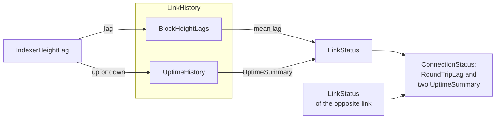

# Network Connectivity Link Observations

## Background

This document builds on the [Network Connectivity Monitor](./network-connectivity-monitor.md), which describes the `ConnectivityMonitor` and what it uses of the types defined here.
It lays out what connectivity data we currently track and how we can turn those into useful observations about link quality.

Concretely, in this document, we explore how we can leverage an `IndexerHeightReport` to make qualitative statements about network connections in the cluster.



## Link observation

An `IndexerHeightReport` reports the reporter's indexer height, as well as the indexer height it has last received from each of its peers.

We can use that to approximate the latency of a link:
```
indexer height lag(A --> B) ~ first_hand_indexer_height(A) - indexer_height of A, as last reported by B
```

```rust
/// a link observation
pub enum IndexerHeightLag {
    /// `reporter` lists `peer`: the height `peer` reported to us first-hand, minus the height
    /// `reporter` lists for it. Zero if `reporter` is ahead.
    Present(BlockCount),
    /// `reporter` lists `peer`, but one of the two heights is unknown, so there is no lag.
    Unknown,
    /// `reporter` does not list `peer`.
    Absent,
}

impl IndexerHeightLag {
    fn new(
        first_hand_indexer_height: ReportedIndexerHeight,
        peer_reported_height: Option<ReportedIndexerHeight>,
    ) -> Self {
        let Some(peer_reported) = peer_reported_height else {
            return IndexerHeightLag::Absent;
        };
        match (first_hand_indexer_height, peer_reported) {
            (ReportedIndexerHeight::Unknown, _) => IndexerHeightLag::Unknown,
            (_, ReportedIndexerHeight::Unknown) => IndexerHeightLag::Unknown,
            (
                ReportedIndexerHeight::Known(first_hand),
                ReportedIndexerHeight::Known(peer_reported),
            ) => {
                let count = first_hand
                    .blocks_since(peer_reported)
                    .unwrap_or(BlockCount::new(0));
                IndexerHeightLag::Present(count)
            }
        }
    }
}
```


### Deriving a link observation from the `IndexerHeightReport`

Recall that in [Network Connectivity Monitor](./network-connectivity-monitor.md), a series of link observations is derived from the peer report via `derive_link_observations`. Recall also the `ObservationContext` that it is given:

```rust
pub struct ObservationContext<'a> {
    pub first_hand_indexer_heights: &'a FirstHandIndexerHeights,
}
```

This is exactly what we do now:

```rust
impl IndexerHeightReport {
    pub fn derive_link_observations(
        &self,
        context: &ObservationContext<'_>,
    ) -> Vec<DerivedLinkObservation> {
        // infers indexer height lag from first hand report in the context and the reported peer heights
        let IndexerHeightReport {
            reporter,
            indexer_heights,
        } = self;
        let mut res = Vec::new();
        for (my_peer, &first_hand) in context.first_hand_indexer_heights.iter() {
            let Ok(link) = DirectedEdge::new(my_peer.clone(), reporter.clone()) else {
                continue;
            };
            let peer_reported_height = indexer_heights.get(my_peer);
            let observation = IndexerHeightLag::new(first_hand, peer_reported_height.copied());
            res.push(DerivedLinkObservation { link, observation });
        }
        res
    }
}
```

## The link status

Recall the `LinkStatus` from [Network Connectivity Monitor](./network-connectivity-monitor.md).
We want the link status to describe:
- whether the link is up or down
- for how long the link has been up
- how often it has been interrupted in the past (as that will help us try to predict how likely it is to break)
- if the link is qualitatively insufficient (is too slow? do block heights arrive too late?)

```rust
pub enum LinkStatus {
    /// The last observation was `Absent`.
    Down,
    Up(UpLink),
}

pub struct UpLink {
    /// The mean of the lags in `BlockHeightLags`. Zero while there are none.
    mean_lag: BlockCount,
    uptime: UptimeSummary,
}

/// What a link's `UptimeHistory` adds up to while the link is up.
pub struct UptimeSummary {
    /// When the running up period started.
    up_since: Instant,
    /// Finished up periods in the history, without the shortest. Each one ended in a disconnect.
    disconnects: u32,
    /// The total length of those finished up periods.
    finished_uptime: Duration,
}
```

## The link type

Now, the link status is a condensed view of the link history, aggregated from a number of link observations.
The idea is that we use uptime history to model the probability that the link will remain up for a given duration.
We also track block height lags, as even though a link may be up, if it is very slow, it may not be suitable for some computations.

The `LinkHistory` is what processes and stores our link observations of type `IndexerHeightLag`, and produces a `LinkStatus`:

```rust
/// What has been measured about one directed link: how far the heights it carries lag behind, and
/// when it was up.
#[derive(Default)]
pub struct LinkHistory {
    lags: BlockHeightLags,
    uptime_history: UptimeHistory,
}

/// The most recent lags of a link (exact number tbd).
#[derive(Default)]
struct BlockHeightLags {
    lags: VecDeque<BlockCount>,
}

/// When a link was up: the last finished up periods (exact number tbd) and the running one.
#[derive(Default)]
struct UptimeHistory {
    /// How long each finished up period lasted. Each one ended in a disconnect.
    finished_uptimes: VecDeque<Duration>,
    /// `None` while the link is down.
    up_since: Option<Instant>,
}
```

```rust
impl LinkHistory {
    pub fn link_status(&self) -> LinkStatus {
        match self.uptime_history.summary() {
            Some(uptime) => LinkStatus::Up(UpLink {
                mean_lag: self.lags.mean(),
                uptime,
            }),
            None => LinkStatus::Down,
        }
    }

    pub fn update_with_observation(
        &mut self,
        observation: IndexerHeightLag,
        at: Instant,
    ) -> LinkStatusChange {
        let previous = self.link_status();
        match observation {
            IndexerHeightLag::Present(lag) => {
                self.uptime_history.record_up(at);
                self.lags.record(lag);
            }
            IndexerHeightLag::Unknown => self.uptime_history.record_up(at),
            IndexerHeightLag::Absent => {
                self.uptime_history.record_down(at);
                self.lags.clear();
            }
        }
        let status = self.link_status();
        if status == previous {
            LinkStatusChange::Unchanged
        } else {
            LinkStatusChange::Changed(status)
        }
    }
}
```


## Connection Status

And finally, recall that two link statuses `A --> B` and `B --> A` must yield the connection status for `A <--> B`:

```rust
impl LinkStatus {
    pub fn infer_connection(
        a: Option<Self>,
        b: Option<Self>,
    ) -> InferredConnection {
        let (Some(Self::Up(a)), Some(Self::Up(b))) = (a, b) else {
            return InferredConnection::NotEstablished;
        };
        match ConnectionStatus::new(a, b) {
            Some(connection) => InferredConnection::Established(connection),
            None => InferredConnection::NotEstablished,
        }
    }
}

pub struct ConnectionStatus {
    round_trip_lag: RoundTripLag,
    /// One per link, each judged on its own. Sorted, so that the status does not depend on which
    /// link changed last.
    uptimes: [UptimeSummary; 2],
}

impl ConnectionStatus {
    /// `None` if the round trip lag of the two links is too high for a connection.
    fn new(a: UpLink, b: UpLink) -> Option<Self> {
        let round_trip_lag = RoundTripLag::new(a.mean_lag, b.mean_lag)?;
        let mut uptimes = [a.uptime, b.uptime];
        uptimes.sort();
        Some(Self {
            round_trip_lag,
            uptimes,
        })
    }
}

#[derive(Clone, Copy, PartialEq, Eq)]
enum RoundTripLag {
    Good,
    /// Above [`AT_RISK_ROUND_TRIP_LAG`] (exact value tbd): the connection may be about to break.
    AtRisk,
}

impl RoundTripLag {
    /// `None` above [`MAX_ROUND_TRIP_LAG`] (exact value tbd): the connection counts as broken.
    fn new(a: BlockCount, b: BlockCount) -> Option<Self> {
        let round_trip = BlockCount::new(u64::from(a).saturating_add(u64::from(b)));
        if round_trip > MAX_ROUND_TRIP_LAG {
            None
        } else if round_trip > AT_RISK_ROUND_TRIP_LAG {
            Some(Self::AtRisk)
        } else {
            Some(Self::Good)
        }
    }
}
```

Finally, the connection status can be used to make a prediction about whether the connection will live long enough to support a computation of a given duration.
```rust
impl ConnectionStatus {
    pub fn connection_supports(
        &self,
        duration: ComputationDuration,
        now: Instant,
    ) -> ComputationSupported {
        let length = match duration {
            ComputationDuration::Any => return ComputationSupported::Yes,
            // 5 seconds
            ComputationDuration::Seconds => SECONDS_COMPUTATION_LENGTH,
            ComputationDuration::HalfMinute if self.round_trip_lag == RoundTripLag::AtRisk => {
                return ComputationSupported::No;
            }
            // 30 seconds
            ComputationDuration::HalfMinute => HALF_MINUTE_COMPUTATION_LENGTH,
        };
        // The time until the next disconnect of a link is assumed to be exponentially distributed:
        //   disconnect rate              = disconnects / up time
        //   chance to stay up for length = exp(-disconnect rate * length)
        // A link that was never seen to disconnect has a rate of zero, so it is supported at once.
        // One disconnect is free, because `disconnects` leaves out the shortest finished up period:
        // when the protocol state changes, a link may come up with a peer that is still in the
        // previous state, and drop again as soon as that peer follows.
        let stays_up = |uptime: &UptimeSummary| {
            // 0.8
            uptime.disconnect_rate(now).chance_to_stay_up(length) >= REQUIRED_CHANCE_TO_STAY_UP
        };
        if self.uptimes.iter().all(stays_up) {
            ComputationSupported::Yes
        } else {
            ComputationSupported::No
        }
    }
}
```

