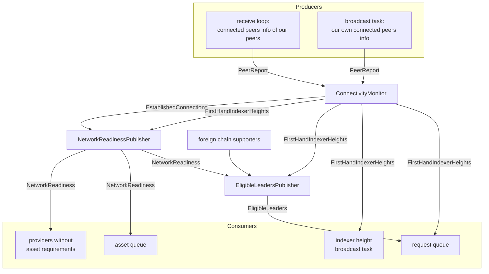
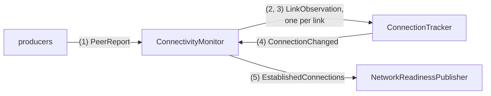
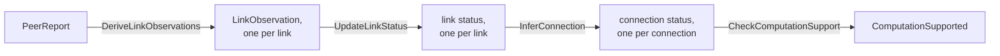

# Network Connectivity Tracker

## Background

The multi party computation (MPC) system we develop and maintain runs threshold cryptography protocols. These protocols may not require all nodes in an MPC cluster to be live, but may succeed if only a subset of those nodes are live.

A lot of threshold cryptography protocols are split into two computation rounds. In a first round, participants of the computation compute some form of asset (e.g. triples or presignatures), which is then used as input to a second computation round, with the same participants.

This allows to distribute computation load and reduces the time to conclude the full protocol.

One caveat is that currently, and to guarantee security for some of these protocols, we require all participants in a computation to have live connections with one another.

Unfortunately, our system currently does not provide our nodes with the means to have a view of the MPC cluster's connectivity state. Right now, the leader of a computation selects participants for said computation based on a simple local view. If the leader can connect with the participants, it assumes that the participants will be able to connect with each other.

This is not an assumption that will be upheld. In production, we have now, multiple times, observed that connectivity is not uniform in the network. There were instances where two peers couldn't establish a stable connection, but those peers didn't have connectivity issues with any of the other nodes.
Additionally, connection quality is **not symmetric**. The link `A --> B` might be perfectly fine, while on `B --> A`, packets arrive late and computations time out.

To fix these issues, this document outlines a design for a **Network Connectivity Tracker**. This is a new component we want to add to the MPC node.
Its purpose is relatively simple:
- it processes and collects observations about network links (i.e. whether the network link `A --> B` is up, since when, how often it broke, its latency)
- it offers an interface that is useful to other components of the node. It can answer questions such as "Do we expect this set of peers to remain fully connected for the duration of `x`?"

## Design

We can distinguish between _consumers_ and _producers_ of the connectivity graph. A consumer is a component that needs a view of network connectivity to make a decision (for example, if a given participant can lead a signature computation). Consumers care about the bidirectional connection between two nodes `A <--> B`.
A producer is a component that produces _observations_ about the network quality. An observation is a measurement of a network link `A --> B`. This can be, for example, latency, i.e. how long it takes for a message from `A` to reach `B`. Or, it can be whether the link `A --> B` is currently up or down.

### Data flow



### Consumers

We have four consumers of the connectivity tracker interface:
- the **indexer height broadcast task**: it wants to know:
    - the latest known block heights that were reported by our live peers
```rust
pub trait ReadFirstHandIndexerHeights {
    fn first_hand_indexer_heights_of(
        &self,
        peers: impl IntoIterator<Item = ParticipantId>,
    ) -> BTreeMap<ParticipantId, ReportedIndexerHeight>;
}

pub enum ReportedIndexerHeight {
    Unknown,
    Known(BlockHeight),
}
```
- the **request queue** wants to know if a given node is eligible to lead a computation. It also needs to know its own current indexer height, to assess whether a given request has timed out or not (c.f. `ReadFirstHandIndexerHeights` above).
```rust
pub trait ReadEligibleLeaders<RequestType> {
    /// Returns the participants that can lead `request`, including us.
    fn read_eligible_leaders(&self, request: &RequestType) -> HashSet<ParticipantId>;
}
```
- the **asset queue**, which wants to know:
    - whether the owner and borrowers of an asset are considered alive and form a clique.
```rust
/// What the participants of an asset are checked against: all of them must be alive, and no two
/// of them may share a broken connection.
/// Generic node type `N` (i.e. ParticipantId, or NodeId)
pub struct NetworkReadiness<N> {
    /// these participants are all reported to be alive
    alive_participants: BTreeSet<N>,
    /// these are connections that are interrupted or not stable enough to support a signature or presignature computation.
    broken_connections: BTreeSet<UndirectedEdge<N>>,
}

impl<N> NetworkReadiness<N> {
    pub fn supports(&self, participants: &[N]) -> bool {
        let is_alive = |participant: &N| self.alive_participants.contains(participant);
        let is_broken = |[a, b]: [&N; 2]| self.is_broken(a, b);
        participants.iter().all(is_alive)
            && !participants.iter().array_combinations::<2>().any(is_broken)
    }
}
```
- the **providers without asset requirements** - i.e. the task that spawns triple computations or signature algorithms that don't require any assets. This component wants the following:
    - give me a random subset of participants who form a clique
    - ensure the clique's connections are sufficiently stable for the specified duration (triple computations currently take around 20-25 seconds, signature computations mostly finish in under 2 seconds).
    - for some computations, we may require the peers' indexer heights to be within a specific window, as nodes lagging behind would refuse to participate in a signature computation if they haven't yet indexed the request themselves.
```rust
/// Chooses a clique of participants: a set in which every two are connected to each other.
pub trait SelectParticipants {
    type Error: std::error::Error + Send + Sync + 'static;

    /// Returns a clique of `participant_count` participants from `eligible` that contains
    /// `must_include` and whose connections are expected to hold for `duration`.
    ///
    /// Errors if `must_include` is not in `eligible`, if no such clique exists, or if the search
    /// for one is given up.
    fn select_participants(
        &self,
        participant_count: usize,
        eligible: &[ParticipantId],
        must_include: ParticipantId,
        duration: ComputationDuration,
    ) -> Result<Vec<ParticipantId>, Self::Error>;
}

pub enum ComputationDuration {
    Any,
    Seconds,
    HalfMinute,
}
```

### Publishers for Consumers

The network connection status the consumers are interested in can be tracked and modeled as an undirected graph:

```rust
/// `N` is the node, `S` is the connection status
pub struct EstablishedConnections<N, S> {
    connections: AdjacencyMatrix<N, S, UndirectedEdge<N>>,
}
```

We need publishers that translate that view to the view that is required by the consumers:

#### Network readiness publisher

The asset queue needs a publisher that maps the connection status `S` to the required computation durations and maintains a current view of any broken connections or peers that are no longer alive.

```rust
/// Derives the [`NetworkReadiness`] for computations of each subscribed [`ComputationDuration`]
/// from the connections and first-hand indexer heights.
/// Publishes whenever the connections change and on every `publish_interval`.
pub(super) struct NetworkReadinessPublisher<N, S> {
    // this struct needs to know the concept of "me", as aliveness of a peer is a comparative criterion:
    // whether their indexer is lagging behind our indexer.
    me: N,
    // maximum indexer height lag after which we consider the peer offline
    max_indexer_height_lag: BlockCount,
    // how often we publish `NetworkReadiness<N>`
    publish_interval: Duration,
    // concept of time, used for publish interval and may be used for assessing connection quality
    clock: Clock,

    // inputs

    // the publisher has a current view of the network connectivity graph
    connections: watch::Receiver<Arc<EstablishedConnections<N, S>>>,
    // the publisher also has a current view of indexer block heights we have collected from all peers
    heights: watch::Receiver<FirstHandIndexerHeights<N>>,

    // outputs

    // publishes, for each computation duration, the network readiness
    readiness: BTreeMap<ComputationDuration, watch::Sender<NetworkReadiness<N>>>,
}

impl<N, S> NetworkReadinessPublisher<N, S>
where
    N: Ord + Hash + Clone,
    S: CheckComputationSupport,
{
    // allows a consumer to subscribe to a NetworkReadiness view of a given computation duration.
    pub(super) fn subscribe(
        &mut self,
        duration: ComputationDuration,
    ) -> watch::Receiver<NetworkReadiness<N>> {
        self.readiness.entry(duration).or_default().subscribe()
    }

    /// Publishes at once, then again when a connection changes, and every `publish_interval` to
    /// pick up the indexer heights and what the passing of time changes. The heights are not a
    /// wake-up source: they are published several times a second. Runs until
    /// `cancellation_token` is cancelled, the monitor is gone or nothing reads the results any
    /// more.
    async fn run(mut self, cancellation_token: CancellationToken);
}
```

#### Participant Selection

Participant selection is a simple wrapper over the `NetworkReadiness` channels provided by the `NetworkReadinessPublisher`:

```rust
struct RandomParticipantClique {
    any: watch::Receiver<NetworkReadiness<ParticipantId>>,
    seconds: watch::Receiver<NetworkReadiness<ParticipantId>>,
    half_minute: watch::Receiver<NetworkReadiness<ParticipantId>>,
}

impl SelectParticipants for RandomParticipantClique {
    type Error = SelectParticipantsError;

    fn select_participants(
        &self,
        participant_count: usize,
        eligible: &[ParticipantId],
        must_include: ParticipantId,
        duration: ComputationDuration,
    ) -> Result<Vec<ParticipantId>, Self::Error> {..}
}
```

#### Eligible Leaders publisher

The asset queue needs something that converts `NetworkReadiness<ParticipantId>` and the `FirstHandIndexerHeights` to a view,
informing it about eligible leaders by request type (and, potentially, by domain id):

```rust
pub(crate) struct EligibleLeadersPublisher {
    me: ParticipantId,
    publish_interval: Duration,
    clock: Clock,
    // the clique sizes we are interested in, that apply to domains other than foreign chain transactions.
    // Matches the reconstruction or signer thresholds of those domains.
    clique_sizes: BTreeSet<usize>,
    // the reconstruction or signer thresholds for foreign chain transaction domains
    foreign_tx_clique_sizes: BTreeSet<usize>,

    // inputs:
    // a view from the NetworkReadinessPublisher
    readiness: watch::Receiver<NetworkReadiness<ParticipantId>>,
    // current block heights
    heights: watch::Receiver<FirstHandIndexerHeights<ParticipantId>>,
    // current foreign chain supporters
    foreign_chain_supporters: watch::Receiver<SupportersByForeignChain>,

    // output:
    eligible_leaders: watch::Sender<EligibleLeaders>,
}
```

```rust
/// A view for the request queue. A node is an eligible leader if it is a member of a clique of sufficient size.
/// A clique is a group of fully connected nodes who:
///     - have a connection deemed sufficiently stable for computing signatures
///     - have reported an indexed block height that is not too far behind the mean of the mpc cluster
///     - in case of the foreign chain tx, each clique member must support the provided foreign chain.
struct EligibleLeaders {
    /// this is a map: reconstruction threshold to each participant that is in a clique of at least `ReconstructionThreshold` participants.
    /// this allows to filter eligible leaders based on threshold
    /// it is a map of eligible participants, keyed by their maximal clique size.
    participants_by_max_clique_size: BTreeMap<usize, BTreeSet<ParticipantId>>,
    /// this allows to filter for eligible leaders by foreign chain.
    /// a participant is considered an eligible leader if both of these conditions are met:
    ///     - they are part of a clique of size `ReconstructionThreshold` or more;
    ///     - each member of that clique supports the foreign chain.
    participants_by_foreign_chain: BTreeMap<(usize, dtos::ForeignChain), BTreeSet<ParticipantId>>,
}
```


```rust
// this struct will implement the trait `ReadEligibleLeaders<RequestType>`
pub(crate) struct EligibleLeaderReader {
    // the clique size required for each domain id
    clique_size_by_domain: HashMap<DomainId, usize>,
    // a receiver holding the latest `EligibleLeaders`
    eligible_leaders: watch::Receiver<EligibleLeaders>,
}

impl<RequestType: Request> ReadEligibleLeaders<RequestType> for EligibleLeaderReader {
    fn read_eligible_leaders(&self, request: &RequestType) -> HashSet<ParticipantId> {..}
}
```


### Producers

With _producers_, we refer to anything that can create an observation useful for the `ConnectivityTracker`. There are two producers for now:
- our own node, in the `broadcast_connected_peers_info` task
- peers, who broadcast their connected peers info.

```rust
/// Generic over node type `N`. Right now, `N` is `ParticipantId`
pub enum PeerReport<N> {
    LegacyIndexerHeightReport(LegacyIndexerHeightReport<N>),
    IndexerHeightReport(IndexerHeightReport<N>),
}

pub struct LegacyIndexerHeightReport<N> {
    pub reporter: N,
    pub indexer_height: ReportedIndexerHeight,
}

pub struct IndexerHeightReport<N> {
    pub reporter: N,
    // the indexer heights this node thinks its peers are at
    pub indexer_heights: BTreeMap<N, ReportedIndexerHeight>,
}
```

In the future, we may extend to add more indexer reports, such as results from an echo-connection check or pings.

### Network Connectivity Manager

We need a component that takes input from producers, processes that input into useful observations about network link status, and then produces a qualitative statement about the network connections (the `EstablishedConnections` graph the publishers above require).

Roughly, this looks as follows:
1. a `PeerReport` is sent to the `ConnectivityMonitor`
2. the `PeerReport` is converted to a series of `LinkObservation`s
3. those `LinkObservation`s are then recorded inside a `ConnectionTracker`, which registers the new observation and determines whether it has an impact on the qualitative status of a connection.
4. the `ConnectionTracker` reports to the `ConnectivityMonitor` whether a connection status changed significantly. Meaning, if two nodes that were previously connected are now no longer connected, or if a connection has degraded and is no longer supporting computations of long durations.
5. If necessary, the `ConnectivityMonitor` then publishes the new `EstablishedConnections` graph to consumers.



```rust
struct ConnectivityMonitor<N, S, M, L> {
    // state
    clock: Clock,
    // for periodically publishing link reports (metrics)
    report_interval: Duration,
    // the interval at which indexer heights are updated.
    // Indexer heights change multiple times per second, but consumers don't need the most up-to-date view.
    // something like 400 ms seems reasonable
    heights_publish_interval: Duration,

    // the indexer heights we have for ourselves and the peers.
    first_hand_heights: FirstHandIndexerHeights<N>,

    // the connection tracker, tracking connection quality and link observations
    connection_tracker: ConnectionTracker<N, S, L>,

    // everything we receive from other components
    peer_reports: mpsc::Receiver<PeerReport<N>>,

    // everything we send to other components
    /// as soon as a connection changes its status, this is updated
    connections: watch::Sender<Arc<EstablishedConnections<N, S>>>,
    /// updated every heights_publish_interval
    heights: watch::Sender<FirstHandIndexerHeights<N>>,
    /// updated every report_interval, for metrics.
    link_statuses: watch::Sender<LinkStatuses<N, M>>,
}

pub struct FirstHandIndexerHeights<N> {
    heights: NonEmptyBTreeMap<N, ReportedIndexerHeight>,
}

/// N is node (e.g. `ParticipantId`), S is connection status, L is link
pub struct ConnectionTracker<N, S, L> {
    // a link is a directed connection node A --> B,
    // each link is measured, such that we can infer link quality from the measurements.
    link_measurements: LinkMeasurements<N, L>,
    // a connection is a bidirectional connection `A <--> B`.
    // It is as good as the worse of the two links `A --> B` and `B --> A`
    established_connections: EstablishedConnections<N, S>,
}

/// `N` is the node, `L` is the link type
pub struct LinkMeasurements<N, L> {
    measurements: AdjacencyMatrix<N, L, DirectedEdge<N>>,
}
```

### Connection Tracker, Links and Connection Status



The `ConnectionTracker` interface reflects what it does:
- it processes a link observation `A --> B` via `update_with_observation` and reports whether the observation changed the qualitative verdict about connection `A <--> B`;

```rust
impl<N: Ord + Hash + Clone, S, L> ConnectionTracker<N, S, L> {
    // this is to process a new link observation
    pub fn update_with_observation<O>(
        &mut self,
        observation: LinkObservation<N, O>,
        now: Instant,
    ) -> Result<ConnectionChanged, UnknownNodeError<N>>
    where
        // the link type `L` must be able to process observation of type `O`
        L: UpdateLinkStatus<O>,
        // the link type `L` must be able to infer a connection status of type `S`
        // from the two links.
        // I.e. the connection A <--> B must be inferrable from links A --> B and B --> A.
        L::LinkStatus: InferConnection<ConnectionStatus = S>,
        // we must be able to tell whether the connection status `S` changed
        S: PartialEq,
    {...}
}

/// Whether an update changed the connection it was applied to.
pub enum ConnectionChanged {
    Yes,
    No,
}
```

- it provides a view of the current connection status via `established_connections`.
```rust
impl<N: Ord + Hash + Clone, S, L> ConnectionTracker<N, S, L> {
    // this returns the currently established connections
    pub fn established_connections(&self) -> &EstablishedConnections<N, S>
}
```

- it additionally offers a constructor and a link status report, which may be used for keeping track of network metrics:
```rust
impl<N: Ord + Hash + Clone, S, L> ConnectionTracker<N, S, L> {
    // constructor, taking as input the current network participants (generic type `N`)
    pub fn new(nodes: &NonEmptyBTreeSet<N>) -> Result<Self, TooManyNodesError>
    // this is for metrics only, we may want to periodically track individual link statuses
    pub fn report_link_statuses(&self) -> LinkStatuses<N, L::LinkStatus>
    where
        L: ReportLinkStatus,
    {..}
}
```

Note the generics:
- The connection tracker supports generic node types `N`. Today, `N` is almost always `ParticipantId`, but, we may decide to change this in the future, as a `ParticipantId` is currently tied to a node operator, not to a node. If in the future we want to change our system to allow connecting to onboarding nodes _before_ they are officially in the participant set, then we will change this type.
- The link type is generic in `L`. In practice, we will probably only maintain a single link type that will be able to process all link observations. The link type we propose is described in [lag-and-uptime-link-type.md](./lag-and-uptime-link-type.md). But for testing the `ConnectionTracker` struct, it helps if we make it generic and define the traits we expect the link type to implement.
- The connection status `S` is generic. This is probably not needed and it does make the struct a tiny bit more complicated, but it does help us separate concerns. `ConnectionTracker` doesn't need to know _what_ a connection status is, it just needs to know that it is some type.

#### Link Type

A link type must be able to process an observation and report whether that observation led to a qualitative change in link quality:

```rust
/// Implemented once per kind of observation `O` a link can take in. Reports the new status in case it changed.
pub trait UpdateLinkStatus<O>: ReportLinkStatus + Default {
    fn update_with_observation(
        &mut self,
        observation: O,
        at: Instant,
    ) -> LinkStatusChange<Self::LinkStatus>;
}

pub enum LinkStatusChange<S> {
    // status changed, contained is the new status
    Changed(S),
    Unchanged,
}
```

Combining two links `A --> B` and `B --> A` must yield a qualitative statement about the connection `A <--> B`.

```rust
/// Implemented by a link status type.
pub trait InferConnection: Sized {
    type ConnectionStatus;
    /// The connection that the two links between a pair of nodes add up to. A link is `None`
    /// while it has no observations.
    fn infer_connection(
        a: Option<Self>,
        b: Option<Self>,
    ) -> InferredConnection<Self::ConnectionStatus>;
}


/// What two link statuses add up to: a connection with a status, or no connection.
/// `S` is the generic connection status
pub enum InferredConnection<S> {
    Established(S),
    NotEstablished,
}

```

Lastly, we would like our link type to be able to report a status that may be useful for metrics and observability:
```rust
pub trait ReportLinkStatus {
    type LinkStatus;
    fn link_status(&self) -> Self::LinkStatus;
}
```

#### Connection status

The struct `EstablishedConnections` keeps track of all currently established connections and a quality verdict.
Since we expect there to be many more healthy connections than unhealthy connections, it is often most efficient to only report the broken connections, or connections that are not meeting a specific connection quality.


A connection status must be able to make qualitative statements about the connection quality:

```rust
impl<N, S> EstablishedConnections<N, S>
where
    N: Ord + Hash + Clone,
    // The connection status `S` must be able to make a verdict whether a specific computation is supported by that connection
    S: CheckComputationSupport,
{
    /// For each of `durations`, every pair of nodes that cannot currently run a computation of
    /// that duration together: their connection is not established, or does not support it.
    pub fn connections_not_supporting(
        &self,
        durations: &BTreeSet<ComputationDuration>,
        now: Instant,
    ) -> BTreeMap<ComputationDuration, BTreeSet<UndirectedEdge<N>>>;
}
```

We require the connection status `S` to be able to make a verdict about whether a computation of a given duration is supported:

```rust
/// can be used to estimate whether a connection is sufficient for a specific computation duration
pub trait CheckComputationSupport {
    fn connection_supports(
        &self,
        duration: ComputationDuration,
        now: Instant,
    ) -> ComputationSupported;
}

pub enum ComputationSupported {
    Yes,
    No,
}

// to be refined. Triples need about 23 seconds, signatures about 2 seconds.
pub enum ComputationDuration {
    Any,
    Seconds,
    HalfMinute,
}
```

#### How to turn a PeerReport into a LinkObservation

The `ConnectivityMonitor` is able to process these reports:
```rust
impl<N, S, M, L> ApplyPeerReport<N, PeerReport<N>> for ConnectivityMonitor<N, S, M, L>
where
    N: Ord + Hash + Clone + std::fmt::Display,
    // the link type must be able to process IndexerHeightLags
    L: UpdateLinkStatus<IndexerHeightLag>,
    // the link status must be able to infer a connection status
    L::LinkStatus: InferConnection<ConnectionStatus = S>,
    // we must be able to check if a connection status changed
    S: PartialEq,
{
    fn apply(&mut self, report: PeerReport<N>) -> Result<ConnectionsChanged, PeerReportError<N>> {
        match report {
            PeerReport::IndexerHeightReport(report) => self.apply(report),
            PeerReport::LegacyIndexerHeightReport(report) => self.apply(report),
        }
    }
}

enum ConnectionsChanged {
    Yes,
    No,
}
```

```rust
impl<N, S, M, L> ApplyPeerReport<N, IndexerHeightReport<N>> for ConnectivityMonitor<N, S, M, L>
where
    N: Ord + Hash + Clone + std::fmt::Display,
    L: UpdateLinkStatus<IndexerHeightLag>,
    L::LinkStatus: InferConnection<ConnectionStatus = S>,
    S: PartialEq,
{
    fn apply(
        &mut self,
        report: IndexerHeightReport<N>,
    ) -> Result<ConnectionsChanged, PeerReportError<N>> {
        // update self.first_hand_heights and update the connections with the report
    }
}

impl<N, S, M, L> ApplyPeerReport<N, LegacyIndexerHeightReport<N>>
    for ConnectivityMonitor<N, S, M, L>
where
    N: Ord + Clone + std::fmt::Display,
{
    fn apply(
        &mut self,
        report: LegacyIndexerHeightReport<N>,
    ) -> Result<ConnectionsChanged, PeerReportError<N>> {
        // update self.first_hand_heights
    }
}
```

The point of the generics here is that we want to make it easy to add new link observations and peer reports.
Adding a new peer report variant is one enum variant plus one `impl ApplyPeerReport<N, NewReport> for ConnectivityMonitor`.


Note that we differentiate between a `PeerReport` and a `LinkObservation`.

Take `IndexerHeightReport` as an example. It contains the indexer heights of every peer the reporter is bidirectionally connected to. In case the reporter isn't connected to a peer, that peer is missing from the report.
We need to turn this into `n` observations, where `n` is the number of nodes in the network. Each observation then tells us:
- whether the link `peer --> reporter` exists
- an approximation for the delay `peer --> reporter`, based on the block count.


Therefore, we need a `DeriveLinkObservations` trait:

```rust
/// Implemented by a report type: the link observations derived from it.
pub trait DeriveLinkObservations<N> {
    type Observation;
    fn derive_link_observations(
        &self,
        context: &ObservationContext<'_, N>,
    ) -> Vec<LinkObservation<N, Self::Observation>>;
}

pub struct ObservationContext<'a, N> {
    pub first_hand_indexer_heights: &'a FirstHandIndexerHeights<N>,
}

impl<N: Ord + Clone> DeriveLinkObservations<N> for IndexerHeightReport<N> {
    type Observation = IndexerHeightLag;

    fn derive_link_observations(
        &self,
        context: &ObservationContext<'_, N>,
    ) -> Vec<LinkObservation<N, IndexerHeightLag>> {
        // infers indexer height lag from first hand report in the context and the reported peer heights
        let IndexerHeightReport {
            reporter,
            indexer_heights,
        } = self;
        let mut res = Vec::new();
        for (my_peer, &first_hand) in context.first_hand_indexer_heights.iter() {
            let Ok(link) = DirectedEdge::new(my_peer.clone(), reporter.clone()) else {
                continue;
            };
            let peer_reported_height = indexer_heights.get(my_peer);
            let observation = IndexerHeightLag::new(first_hand, peer_reported_height.copied());
            res.push(LinkObservation { link, observation });
        }
        res
    }
}
```

