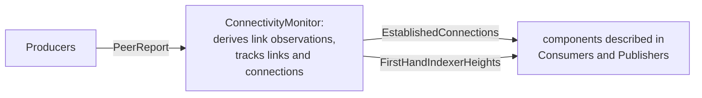
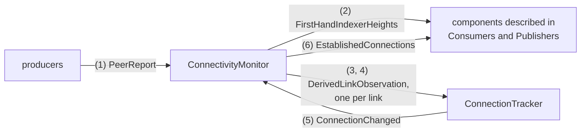
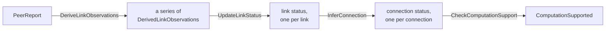

# Network Connectivity Monitor

## Background

The multi party computation (MPC) system we develop and maintain runs threshold cryptography protocols. These protocols may not require all nodes in an MPC cluster to be live, but may succeed if only a subset of those nodes are live.

A lot of threshold cryptography protocols are split into two computation rounds. In a first round, participants of the computation compute some form of asset (e.g. triples or presignatures), which is then used as input to a second computation round, with the same participants.

This allows to distribute computation load and reduces the time to conclude the full protocol.

One caveat is that currently, and to guarantee security for some of these protocols, we require all participants in a computation to have live connections with one another.

Unfortunately, our system currently does not provide our nodes with the means to have a view of the MPC cluster's connectivity state. Right now, the leader of a computation selects participants for said computation based on a simple local view. If the leader can connect with the participants, it assumes that the participants will be able to connect with each other.

This is not an assumption that will be upheld. In production, we have now, multiple times, observed that connectivity is not uniform in the network. There were instances where two peers couldn't establish a stable connection, but those peers didn't have connectivity issues with any of the other nodes.
Additionally, connection quality is **not symmetric**. The link `A --> B` might be perfectly fine, while on `B --> A`, packets arrive late and computations time out.

To fix these issues, this document, together with [Network Connectivity Consumers and Publishers](./network-connectivity-consumer-publishers.md) and [Network Connectivity Link Observations](./network-connectivity-link-observations.md), outlines the design for components that will allow MPC nodes to have a better understanding of the network connections inside the MPC cluster.

## Design

The design is broken into three orthogonal parts:
- [Network Connectivity Consumers and Publishers](./network-connectivity-consumer-publishers.md) is focused on the **consumers** in the network. It explores four different components of the MPC node, that require an understanding of the network connectivity graph. It aims to identify appropriate interfaces and data structures that are useful to these components, and explains how each of those can be derived by combining two views:
    - a graph, presenting a current view of _established network connections_ in the MPC cluster
    - a current view of the _indexer block heights_ each peer has last reported as processed. This is necessary, because in our system, an MPC node cannot simply be considered "live", just because it has good connections with its peers. Each node also needs a current view of the NEAR blockchain.
- [Network Connectivity Link Observations](./network-connectivity-link-observations.md) contains a proposal on how the indexer height data, which our MPC nodes are currently gossiping, can be used to **derive qualitative statements** about the connection between a given pair of nodes in the cluster.
- The remainder of this document explores a **Network Connectivity Monitor** component, whose responsibility it is to process data that allows one to make conclusions about liveness of nodes. Currently, that entails two responsibilities:
    - it needs to keep an up to date view of the last processed _indexer block height_ by each peer;
    - it needs to maintain a current view of _established network connections_.

  It does so by aggregating data from producers and sharing the two views above with the components described in [Network Connectivity Consumers and Publishers](./network-connectivity-consumer-publishers.md).

The two views are:

```rust
/// Mapping each node `N` in the cluster to its last reported indexer height
pub struct FirstHandIndexerHeights<N> {
    heights: NonEmptyBTreeMap<N, ReportedIndexerHeight>,
}

/// A current view of established connections. If an edge is not present, it means the connection is not bidirectionally established (i.e. broken in one or both directions).
/// `N` is the node, `CS` is the connection status
pub struct EstablishedConnections<N, CS> {
    connections: AdjacencyMatrix<N, CS, UndirectedEdge<N>>,
}
```

Below is an overview of the data flow:



## Peer Reports and Producers

Terminology:
- a _peer report_ is a report containing information useful to derive verdicts about the reporter's liveness, and connections they have with their _peers_. Currently, we only support one peer report:
    - A peer's `IndexerHeightReport`, containing the block height the reporter's indexer has last processed, as well as the last reported indexer block height of each peer, who is bidirectionally connected to the reporter.

  Note that this report is broadcast once a second by every node in the cluster.
- a _producer_ is something that can produce a _peer report_. Currently, we have two producers in the node:
    - the node's own indexer height broadcast task: it inspects the network layer and filters for all participants that are currently bidirectionally connected to the node, checks the latest indexer heights it has received from these nodes and also has a current view of the last processed indexer height of the node itself. It broadcasts that information to all its peers. This will be a source we must process.
    - the network layer, which forwards peer reports received from connected nodes.

```rust
/// Generic over node type `N`. Right now, `N` is `ParticipantId`
pub enum PeerReport<N> {
    IndexerHeightReport(IndexerHeightReport<N>),
}

pub struct IndexerHeightReport<N> {
    pub reporter: N,
    // the reporter's own indexer height, under its own key, and the heights it last received from its peers
    pub indexer_heights: BTreeMap<N, ReportedIndexerHeight>,
}

pub enum ReportedIndexerHeight {
    Unknown,
    Known(BlockHeight),
}
```

In the future, we may add new types of peer reports, such as results from echo-connection checks or pings.

## The `ConnectivityMonitor`

We need a component that can collect peer reports, process them, and update the two structs consumers care about (`EstablishedConnections` and `FirstHandIndexerHeights`). We call this component `ConnectivityMonitor`.

Roughly, data is processed as follows:
1. A `PeerReport` is sent to the `ConnectivityMonitor`.
2. If the `PeerReport` contains information about first hand indexer heights, the `ConnectivityMonitor` updates and **publishes** `FirstHandIndexerHeights`.
3. The `PeerReport` is converted to a series of **link observations** (`DerivedLinkObservation`), which are observations about directed **network links** `A --> B`.
4. Those `DerivedLinkObservation`s are then passed to a connection tracker (`ConnectionTracker`), which registers the new observation and determines whether it has an impact on the **qualitative status of a network connection** (where, a connection `A <--> B` is derived from the links `A --> B` and `B --> A`).
5. The `ConnectionTracker` reports to the `ConnectivityMonitor` whether a connection status changed qualitatively (e.g. it got interrupted, or re-established, or the quality of the connection changed otherwise).
6. If a connection status changed, the `ConnectivityMonitor` **publishes** a new `EstablishedConnections` graph.



```rust
struct ConnectivityMonitor<N, CS, LS, L> {
    // state
    clock: Clock,
    // for periodically publishing link reports (metrics)
    report_interval: Duration,

    // the connection tracker, tracking connection quality and link observations
    connection_tracker: ConnectionTracker<N, CS, L>,

    // everything we receive from other components
    peer_reports: mpsc::Receiver<PeerReport<N>>,

    // everything we send to other components
    /// as soon as a connection changes its status, this is updated
    connections: watch::Sender<Arc<EstablishedConnections<N, CS>>>,
    /// the indexer heights we have for ourselves and the peers, updated with every `PeerReport`
    heights: watch::Sender<FirstHandIndexerHeights<N>>,
    /// updated every report_interval, for metrics.
    link_statuses: watch::Sender<LinkStatuses<N, LS>>,
}

```

### Interface of `ConnectivityMonitor`

The `ConnectivityMonitor` is able to process peer reports (c.f. subsequent subsections for explanation on the trait bounds):
```rust
impl<N, CS, LS, L> ConnectivityMonitor<N, CS, LS, L>
where
    N: Ord + Hash + Clone,
    CS: Clone,
    L: ReportLinkStatus<LinkStatus = LS>,
{
    /// Returns the monitor, which the caller has to run, and its channels.
    pub fn new(
        clock: Clock,
        report_interval: Duration,
        nodes: &NonEmptyBTreeSet<N>,
        report_buffer_size: NonZeroUsize,
    ) -> Result<(Self, ConnectivityMonitorHandles<N, CS, LS>), TooManyNodesError>;
}

impl<N, CS, LS, L> ConnectivityMonitor<N, CS, LS, L>
where
    N: Ord + Hash + Clone + std::fmt::Debug + std::fmt::Display,
    CS: Clone + PartialEq,
    L: UpdateLinkStatus<IndexerHeightLag, LinkStatus = LS>,
    LS: InferConnection<ConnectionStatus = CS>,
{
    /// Runs until `cancellation_token` is cancelled or every sender of peer reports is gone.
    pub async fn run(mut self, cancellation_token: CancellationToken);
    fn apply_and_publish(&mut self, report: PeerReport<N>);
}
```

`new` returns the monitor together with its handles:

```rust
/// The channels of a `ConnectivityMonitor` that the other components use.
pub struct ConnectivityMonitorHandles<N, CS, LS> {
    // producers send their peer reports here
    pub peer_reports: mpsc::Sender<PeerReport<N>>,
    pub connections: watch::Receiver<Arc<EstablishedConnections<N, CS>>>,
    // the times stored in `connections` are from this clock, so ask them with its `now`
    pub clock: Clock,
    pub heights: watch::Receiver<FirstHandIndexerHeights<N>>,
    pub link_statuses: watch::Receiver<LinkStatuses<N, LS>>,
}

/// The status of each link, keyed by its two nodes. For metrics.
pub struct LinkStatuses<N, LS>(BTreeMap<(N, N), LS>);
```

### Links, Connection Status and Link Observations

Note that at this stage, we do not need to commit to any specific link or connection types. All we need to know is:
- The graphs index vertices by a label `N`, which represents a node in the MPC cluster. That label can be `ParticipantId`, or, in the future, we may want to use a more precise type, since a single participant could have multiple nodes (e.g. during migrations).
- A connection status is of some generic type `CS`.
- The type used to track links and their status is a generic type `L`. For the `ConnectivityMonitor` the exact shape of `L` is completely irrelevant.
- A link status is of some generic type `LS`. It is what the link type `L` reports about itself (`L::LinkStatus`).
- A link observation is of some type `O`. Unlike the types above, `O` is not a free parameter of the `ConnectivityMonitor`: it is determined by the `PeerReport` it is derived from. Currently, we only have one peer report and the only link observation type derived form it is `IndexerHeightLag` (c.f. [Network Connectivity Link Observations](./network-connectivity-link-observations.md)). In the future, we may add more peer reports and more observation types (such as results from echo-connection checks).

Now, we do require these types to fulfill certain traits:
- The link type must be able to report link status `LS` (the `LinkStatuses<N, LS>` above), which helps determine whether an observation led to a link status change.
```rust
pub trait ReportLinkStatus {
    type LinkStatus;
    fn link_status(&self) -> Self::LinkStatus;
}
```
- The link type `L` must be able to process any of the link observations that the producers want the connectivity monitor to process. Additionally, it must report whether an observation led to a new link status:
```rust
/// Implemented once per kind of observation `O` a link can take in. Reports the new status in case it changed.
pub trait UpdateLinkStatus<O>: ReportLinkStatus + Default {
    fn update_with_observation(
        &mut self,
        observation: O,
        at: Instant,
    ) -> LinkStatusChange<Self::LinkStatus>;
}

pub enum LinkStatusChange<LS> {
    // status changed, contained is the new status
    Changed(LS),
    Unchanged,
}
```
- The connection status `CS` for a connection `A <--> B` must be inferrable from the link statuses `LS` of the two links `A --> B` and `B --> A`:
```rust
/// Implemented by a link status type.
pub trait InferConnection: Sized {
    type ConnectionStatus;
    /// The connection that the two links between a pair of nodes add up to. A link is `None`
    /// while it has no observations.
    fn infer_connection(
        a: Option<Self>,
        b: Option<Self>,
    ) -> InferredConnection<Self::ConnectionStatus>;
}

/// What two link statuses add up to: a connection with a status, or no connection.
/// `CS` is the generic connection status
pub enum InferredConnection<CS> {
    Established(CS),
    NotEstablished,
}
```
- The connection status `CS` must be able to make qualitative statements about a connection's quality (c.f. [Network readiness publisher](./network-connectivity-consumer-publishers.md#network-readiness-publisher)):
```rust
/// can be used to estimate whether a connection is sufficient for a specific computation duration
pub trait CheckComputationSupport {
    fn connection_supports(
        &self,
        duration: ComputationDuration,
        now: Instant,
    ) -> ComputationSupported;
}

pub enum ComputationSupported {
    Yes,
    No,
}

// to be refined. Triples need about 23 seconds, signatures about 2 seconds.
pub enum ComputationDuration {
    Any,
    Seconds,
    HalfMinute,
}
```
- And lastly, the link observations of type `O` can be derived from the provided `PeerReport`:
```rust
/// Implemented by a report type: the link observations derived from it.
pub trait DeriveLinkObservations<N> {
    type Observation;
    fn derive_link_observations(
        &self,
        context: &ObservationContext<'_, N>,
    ) -> Vec<DerivedLinkObservation<N, Self::Observation>>;
}

pub struct DerivedLinkObservation<N, O> {
    pub link: DirectedEdge<N>,
    pub observation: O,
}

pub struct ObservationContext<'a, N> {
    pub first_hand_indexer_heights: &'a FirstHandIndexerHeights<N>,
}

```



### `ConnectionTracker`

The `ConnectionTracker` is the component responsible for maintaining the `EstablishedConnections` graph, which the consumers rely on.
Besides the undirected `EstablishedConnections` graph, it keeps a directed graph to track network links `A --> B`. This directed graph is updated with every new link observation.

```rust
/// N is node (e.g. `ParticipantId`), CS is connection status, L is link
pub struct ConnectionTracker<N, CS, L> {
    // a link is a directed connection node A --> B,
    // each link is measured, such that we can infer link quality from the measurements.
    link_measurements: LinkMeasurements<N, L>,
    // a connection is a bidirectional connection `A <--> B`.
    // It is as good as the worse of the two links `A --> B` and `B --> A`
    established_connections: EstablishedConnections<N, CS>,
}

/// `N` is the node, `L` is the link type
pub struct LinkMeasurements<N, L> {
    measurements: AdjacencyMatrix<N, L, DirectedEdge<N>>,
}
```

The interface of the `ConnectionTracker` reflects what it does:
- it processes a link observation `A --> B` via `update_with_observation` and reports whether the observation changed the qualitative verdict about connection `A <--> B`;
```rust
impl<N: Ord + Hash + Clone, CS, L> ConnectionTracker<N, CS, L> {
    // this is to process a new link observation
    pub fn update_with_observation<O>(
        &mut self,
        observation: DerivedLinkObservation<N, O>,
        now: Instant,
    ) -> Result<ConnectionChanged, UnknownNodeError<N>>
    where
        // the link type `L` must be able to process observation of type `O`
        L: UpdateLinkStatus<O>,
        // the link type `L` must be able to infer a connection status of type `CS`
        // from the two links.
        // I.e. the connection A <--> B must be inferrable from links A --> B and B --> A.
        L::LinkStatus: InferConnection<ConnectionStatus = CS>,
        // we must be able to tell whether the connection status `CS` changed
        CS: PartialEq,
    {...}
}

/// Whether an update changed the connection it was applied to.
pub enum ConnectionChanged {
    Yes,
    No,
}
```
- it provides a view of the current connection status via `established_connections`.
```rust
impl<N: Ord + Hash + Clone, CS, L> ConnectionTracker<N, CS, L> {
    // this returns the currently established connections
    pub fn established_connections(&self) -> &EstablishedConnections<N, CS>
}
```
- it additionally offers a constructor and a link status report, which may be used for improving observability (i.e. metrics), but is not assumed to be of interest to any of the consumers:
```rust
impl<N: Ord + Hash + Clone, CS, L> ConnectionTracker<N, CS, L> {
    // constructor, taking as input the current network participants (generic type `N`)
    pub fn new(nodes: &NonEmptyBTreeSet<N>) -> Result<Self, TooManyNodesError>
    // this is for metrics only, we may want to periodically track individual link statuses
    pub fn report_link_statuses(&self) -> LinkStatuses<N, L::LinkStatus>
    where
        L: ReportLinkStatus,
    {..}
}
```

## Todo

This design assumes that every peer sends an `IndexerHeightReport`; peers on older network protocol versions do not. We therefore need to bump the lowest supported network protocol version, and can then remove the deprecated code for supporting older protocol versions.


