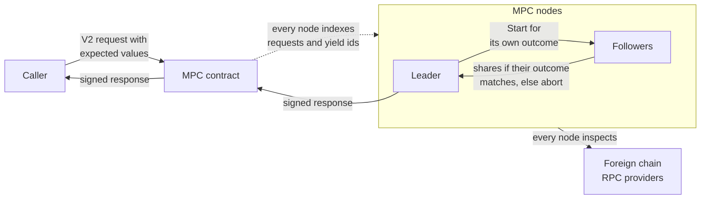
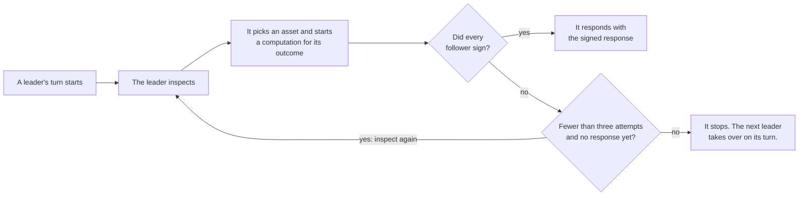

# Signed Negative and Inconclusive Outcomes for Foreign Transaction Verification

**Status:** Draft for discussion · **Author:** Haiyue Chen (with Claude) · **Date:** 28 September 2026, revised 19 November 2026

**Note on naming:** the new caller facing method is `read_rpc`. To ease comparison with current
foreign transaction verification (V1), the doc calls the new flow V2.

## Summary

Today a foreign transaction request is signed only when the transaction checks out. Anything
else times out after the 200 block yield window, so a caller can't tell a failed transaction
from an MPC outage.

With this design, a V2 request gets one of three signed responses:

- **Verified:** the transaction checks out with the expected values.
- **Negative:** the transaction doesn't check out as requested. For example, it failed, was not
  found, has other values, or is not final enough yet. The response doesn't say which, and a
  later request can get a different one, because the transaction may still land.
- **Inconclusive:** each honest signer found no conclusive outcome, because its providers
  disagreed or too few of them replied. It says nothing about the transaction.

The request times out if the nodes fail to reach quorum on any of these outcomes.

The main points of the design:

- Callers opt in through a new method, `read_rpc`, and name the signing key by its root public
  key. `verify_foreign_transaction` (V1) is unchanged.
- Each response is bound to one yield, to the request's block height and to the caller's
  expected values.
- An honest leader signs only what it found, and an honest follower signs only if it found the
  same. So the signers of one computation always agree on the message, with no extra round.
- Each leader makes up to three attempts, and backup leaders take over on a fixed schedule.
- Every inconclusive outcome raises a warning.

## Vocabulary

| Term | Meaning |
|---|---|
| Conclusive | Verified or negative. |
| Node outcome | What one node concludes from its providers: verified, negative, or inconclusive. |
| Response | The signed outcome the caller gets. |
| Asset | Signing material that t participants generated together. One computation uses it up. |
| Start | The message that opens a computation. It names the task id and the participants. |
| Computation | One run of the threshold signing protocol (one MPC task), for one message with one asset. A leader starts it and the asset's borrowers join it as followers. |
| Attempt | A leader's try at getting a request signed. Each attempt is one computation, and each leader makes up to three per request. |
| Leader | The node that starts an attempt. Nodes lead in the queue's leader selection order, each from its turn on, while no response has landed. Later nodes in that order are backup leaders. |
| t, s, n | t is the reconstruction threshold of the foreign transaction domain. Every asset is shared by exactly t participants: its owner, which is the leader, and t − 1 borrowers. s is the number of nodes that support the request's chain, and n the number of participants. |

---

## Architecture



1. **Request.** The caller calls `read_rpc` with the values it expects. The contract stores the
   request under a new yield id and announces the id in an event.
2. **Inspect.** Every node that can inspect the request does so once the request's block is
   final.
3. **Start.** The leader picks an asset and sends Start for the outcome it found.
4. **Sign or abstain.** Each follower signs if its own outcome matches. If not, it inspects once
   more, then signs on a match or abstains.
5. **Respond.** The leader submits the yield id, the outcome and the signature. The contract
   checks the signature and resumes that yield.
6. **Failover.** If no response has landed when the next leader's turn starts, that leader
   inspects and makes its own attempts.

### Node outcomes

A node asks every provider it has configured, whitelisted or not, and maps each provider
response to a provider outcome:

| Provider response | Provider outcome |
|---|---|
| Found, with values equal to the expected ones | verified |
| Found, with values that differ | negative |
| Failed, not found, log index out of bounds, account not found, block not canonical | negative |
| Not finalized, or fewer block confirmations than requested | negative |
| Transport error, timeout, rejected call, malformed or inconsistent response, log not bound to its receipt | error |

The node outcome aggregates the provider outcomes and ignores errors:

- **Verified or negative,** when every provider without an error gave the same one, and at
  least the chain's quorum of whitelisted providers are among them.
- **Inconclusive,** when providers disagree, whitelisted or not, or when fewer whitelisted
  providers than the chain's quorum gave one.

So *not found* and *failed* agree on negative. A rejected call is an error, not a negative,
because a misconfigured provider rejects calls too.

A node can't inspect a request when it doesn't support the chain, has fewer whitelisted
providers configured than the chain's quorum, or can't convert the request. It then abstains
from every computation for that request and never leads it.

### Attempts

Each attempt uses one asset. The task id comes from the request, the asset and an outcome, so
one attempt has three possible task ids. The Start names one of them, which fixes the message
to sign. Each signer builds that message from its own indexed request and the Start's outcome,
and a follower signs only if that outcome is also its own (step 3). So followers that got
Starts for different outcomes never join the same computation.

1. **Start.** The leader inspects, then sends Start for the outcome it found.
2. **Check.** Before it calls any provider, a follower refuses the Start unless all of these
   hold:
   - The request is open: no response has landed, and its block is at most 200 blocks old.
   - The sender supports the chain, by the follower's view of the contract.
   - The sender has sent the follower at most three Starts for this request, refused ones
     included. This gives each leader three attempts.
   - The asset is the sender's, the Start lists exactly its owner and borrowers, and the
     follower is one of the borrowers.

   Chain support always comes from the chains each node registered with the contract, never
   from a node's own claim. A follower that hasn't indexed the request yet waits for it, as in
   V1. Followers don't check whose turn it is. A follower that accepts a Start uses up its share of the asset.
3. **Compare.** The follower signs if its node outcome matches the Start's. If it has none, or
   they differ, it inspects once more, then signs if the new outcome matches, inconclusive
   included, and abstains otherwise. Refusing
   and abstaining both send an abort.
4. **Result.** If every follower signs, the leader submits the response. Otherwise it inspects
   again and retries with another asset, up to three attempts, unless a response has landed.



Each attempt has a deadline, long enough for a follower to inspect and sign. The implementation
tunes it and the inspection deadline.

#### When nodes inspect

With failover, one node can follow some leaders and lead its own attempts for the same
request. It keeps one node outcome per request, from its latest inspection, for both roles. It
keeps only conclusive outcomes, so after an inconclusive inspection it has none.

A node inspects:

- **At finality,** so followers of the first attempt need no provider call after Start.
- **As leader, before each attempt,** so retries and backup leaders work from new outcomes.
  For the first leader's first attempt, its inspection at finality is that inspection. Each
  attempt is for the outcome the leader finds then.
- **As follower, once per Start it can't match.** So it inspects at most three times per sender
  and request.

When nodes differ at the edge of finality, these new inspections let a later attempt sign once
the nodes catch up. A first attempt costs one inspection and one computation after finality.
Each retry adds at most one attempt deadline and one inspection, and each backup leader one
failover interval.

#### Picking assets

A leader only uses an asset whose borrowers all support the chain, by its view of the contract,
and have a recent view of NEAR, so each borrower has indexed the request when Start arrives.

#### Races between leaders

Turns follow a fixed schedule, so two leaders can sign different outcomes for one yield, for
example a negative and then a verified outcome once the transaction lands. The contract accepts
the first response and rejects the other. We accept this race instead of adding a round to make
leaders agree: each signed outcome is what an honest node found.

### Payload and response types

```rust
enum ForeignTxSignPayload {
    V1(ForeignTxSignPayloadV1),                    // unchanged
    V2(ForeignTxSignPayloadV2),
}

struct ForeignTxSignPayloadV2 {
    request: ForeignChainRpcRequest,
    expected_values_hash: Hash256,                 // sha256(borsh(expected_values)), length prefix included
    request_block_height: BlockHeight,             // the block that executed the request's receipt
    yield_id: YieldId,                             // the one yield this resumes
    outcome: ReadRpcOutcome,
}

enum ReadRpcOutcome {
    Verified {},                                   // the values match the expected ones
    Negative {},                                   // the transaction doesn't check out as requested
    Inconclusive {},
}

struct YieldId([u8; 32]);                          // picked by the contract, see "Yield ids"

struct ReadRpcRequestArgs {
    request: ForeignChainRpcRequest,
    domain_public_key: PublicKey,                  // root public key of a foreign tx domain
    expected_values: Vec<ExtractedValue>,          // one per extractor, in extractor order
}

struct ReadRpcResponse {
    payload_hash: Hash256,
    signature: SignatureResponse,
    request_block_height: BlockHeight,
    yield_id: YieldId,
    outcome: ReadRpcOutcome,
}
```

**Payload**
- The payload hash is the sha256 of the Borsh encoded `ForeignTxSignPayload`, enum tag
  included.
- `ForeignTxPayloadVersion` stays V1 only.
- A negative carries no reason. Each node logs its own.

**Expected values**
- The contract stores only their hash, because the values have no size cap.
- Nodes read the values from the request's receipt.
- The contract rejects a wrong number of values for the extractors.
- It also rejects a value outside its chain's range, such as a Starknet id that isn't a field
  element.

**Public key**
- Callers already hold the root public key, because they need it to verify the signature.
- The contract resolves the key to a foreign transaction domain, or rejects the request.
- Callers never handle domain ids. Only the event that nodes read carries one.

**No expected payload hash, unlike V1**
- The yield id protects against replay.
- The caller can't compute the payload hash in advance, because the contract sets the block
  height.

**Receivers outside NEAR**
- They take the request and expected values from their own records.
- They take the yield id, block height and outcome from the response.
- They rebuild the payload and verify it with the root public key.
- They reject yield ids they have already used.
- They set the age they accept from the block height.
- They can't tell a response to their own request from one to an identical copy (see "Replay
  and reuse").
- The SDK's signature verifier gets V2 support.

### Yields and the respond method

In V1, one response resolves every pending request with the same arguments. That is wrong for a
negative once the transaction lands. So in V2:
- A response resumes a single yield.
- Nodes queue identical requests separately by receipt id.

**Yield ids**

The contract creates each yield with `promise_yield_create_with_id`, under an id it derives from
a counter, and resumes it with `promise_yield_resume_with_yield_id`. Both host functions need
NEAR protocol version 85 or later. Under the id, the contract stores the request, its domain,
the expected values hash and the block height.

The contract logs the id and the domain id in a `read_rpc_yield_created`
[NEP 297](https://github.com/near/NEPs/blob/master/neps/nep-0297.md) event. Nodes read the event
only from a `read_rpc` receipt that succeeded, because a failed receipt keeps its logs.

**The respond method**

```rust
fn respond_read_rpc(yield_id: YieldId, outcome: ReadRpcOutcome, signature: SignatureResponse)
```

It makes V1's respond checks, rebuilds the payload hash from the stored request and the
submitted outcome, verifies the signature with the request's root public key, and resumes the
yield with a `ReadRpcResponse`.

---

## Q&A

### Why a new request method?

V1 must not change. Extending V1 in place changes every V1 payload hash. A new
`payload_version` value on the V1 method would switch the shape of both the request and the
response behind one flag. So V2 gets its own method and request type.

### Why does each leader sign only its own outcome?

Every signer of a computation must sign the same message, but nodes can find different
outcomes.

- **Bind the computation to the request only, as V1 does.** Followers that found different
  outcomes would sign different messages.
- **Collect outcomes from every node first, then sign among the nodes that agree.** Every
  response costs one more round, and nodes need keys registered with the contract.
- **Sign only verified responses with the threshold key, and the rest with node keys.** Much
  more data goes on chain, and a receiver must check many keys.
- **Each leader signs its own outcome, and followers join only on a match (chosen).** A failure
  to reach quorum then times out.

### Why is a failure to reach quorum never signed as inconclusive?

Followers with a conclusive outcome would need proof that others disagree. Signed node outcomes
as evidence need node keys registered with the contract, and the safe rule needs s − t + 1
nodes that didn't find each conclusive outcome, which is the collect first design again. Sending
every outcome to every node needs no keys, but adds a message from every node for every
inspection. We expect a failure to reach quorum to be rare, and a timeout tells the caller the
same thing: try again later. Either option can be added later if failures to reach quorum turn
out to be common.

### How many attempts does a leader make?

Three. In a simulation with s = 17, t = 11 and four leaders, one node that always aborts makes
17% of requests time out with one attempt per leader, and 0.6% with three. Two such nodes make
25% time out, or none once retries avoid failing nodes (see "Later work"). A bad
share doesn't show its sender, so retries can't avoid it. Four honest leaders use at most twelve
assets per request.

### How does V2 roll out?

No upgrade order breaks V1 callers. P2P needs one protocol version bump, for the new task kind.
Aborts reuse the existing message. The `read_rpc` method ships in its own contract release once
every node supports V2, because old nodes would ignore V2 requests. That release also needs NEAR
protocol version 85 or later.

---

## Security analysis

We assume, as V1 does, that fewer than t nodes are malicious. A signature needs all t
participants of one asset, so at least one of them is honest, and an honest node signs only the
outcome of its own latest inspection. Most defenses below follow from that.

### Leaders and followers

| Threat | Defense |
| --- | --- |
| Malicious leader forges an outcome, conclusive or inconclusive | Honest followers join only a computation for their own outcome, and a node that can't inspect abstains. |
| Malicious leader picks among honest outcomes | Not prevented. With t − 2 malicious borrowers, one honest follower that agrees is enough, so while honest nodes differ the leader can get a minority outcome signed. Each signer still found what it signed. |
| Leader signs for a request that doesn't exist, is resolved, or is older than 200 blocks | Honest followers check the request against their own indexer (see "Attempts", step 2). |
| Malicious node uses up assets or provider calls with Starts | Each follower takes at most three Starts per sender and request, refused ones included, and only for the sender's own assets. So across all followers, at most 3(n − 1)/(t − 1) Starts from one sender fit within the cap per request. Each Start uses up the sender's asset, refused or not, and costs each follower at most one inspection. |
| Malicious node shifts who leads | Not new. V2 uses the queue's leader rule unchanged. |
| Followers of one computation sign different messages | The task id names the outcome, and a computation lists exactly the asset's owner and borrowers. |
| Follower abstains, stays silent or sends a bad share | Liveness only. The leader checks the summed signature against the root public key, as in V1, and retries. A bad share doesn't show its sender (see "How many attempts does a leader make?"). |

### Providers

| Threat | Defense |
| --- | --- |
| Honest nodes find different reasons for one negative | A negative carries no reason, so honest nodes sign the same bytes. |
| Faulty providers drive a conclusive outcome | Only if, at every honest participant of an asset, they reach the chain's quorum while every other provider returns an error. V1 has the same limit. A provider that lies to every node only makes those nodes inconclusive. |

### Replay and reuse

| Threat | Defense |
| --- | --- |
| V2 response passed off as a `sign()` or V1 signature, or the other way round | Foreign transaction domains have their own key, the contract checks a domain's purpose, and the enum tag separates V1 from V2. |
| Old negative replayed after the transaction lands | On NEAR each signature resumes one yield, and a new request gets its own inspection. Outside NEAR the block height bounds when the nodes inspected. |
| Response replayed on another caller's request | On NEAR the contract resumes only the yield the signature names. Outside NEAR a response to an identical request passes (see "Caller resubmits copies of a request"). |
| Two outcomes signed for one yield | The contract accepts the first. Each is what an honest node found (see "Races between leaders"). |
| Negative for a transaction that does or will check out | Not prevented. Anyone can get one by asking early or stating wrong values. A receiver must use its own expected values and never treat a negative as proof that the transaction won't land. |

### Callers, contract and node state

| Threat | Defense |
| --- | --- |
| Caller plants a fake yield id | Nodes read the id only from the contract's event in a `read_rpc` receipt that succeeded. |
| Caller predicts or picks the leaders | Not new. The leader order follows the request's receipt id, not the predictable yield id. |
| Caller resubmits copies of a request until one gets a malicious leader | Not prevented outside NEAR, where the copy's response looks like one to the original. On NEAR it resumes only the copy's yield. |
| Caller causes inconclusives or floods requests | The contract rejects malformed requests. Provider disagreement costs the caller a request and raises an alert. The implementation sets how. Every supporting node inspects each request, every attempt uses an asset, and provider quotas are shared with V1. We accept that as the cost of signing every outcome. |
| Receiver trusts the outcome label without checking the signature | Safe on NEAR, where the contract checked it. Outside NEAR the receiver must check it. |
| Leader submits a signature with a different outcome | The contract rebuilds the payload hash from the submitted outcome. |
| Late timeout removes an open request | A timeout removes only its own yield's entry. |
| Node restarts or reshares during a request | Queue state, node outcomes and Start counts live in memory and are lost. As in V1, the node refuses Starts for the request until its indexer processes it again, so the request can time out. New Start counts let a sender exceed the cap there, which costs assets, not safety. |

---

## Later work

These don't change the design and can follow the first version.

**Avoiding failing nodes.** The leader prefers assets without borrowers that aborted or stayed
silent in its earlier attempts for this request, or that didn't reply at all to its recent
Starts. It keeps that record to itself. Until then, a node that is online but always aborts
keeps getting picked: one such node makes 0.6% of requests time out, and two make 25% (see "How
many attempts does a leader make?").

**Alerts.** Verified and negative are expected outcomes. On call gets an alert when the rate
of signed inconclusive outcomes or of V2 request timeouts passes a limit. An inconclusive
outcome most often points to a failing provider or an attack on the cluster's provider
connections, and a network that can't sign shows only as timeouts.
