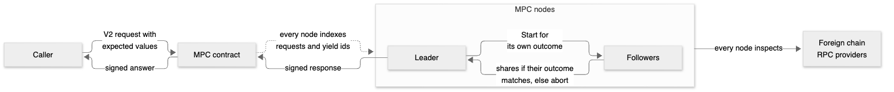
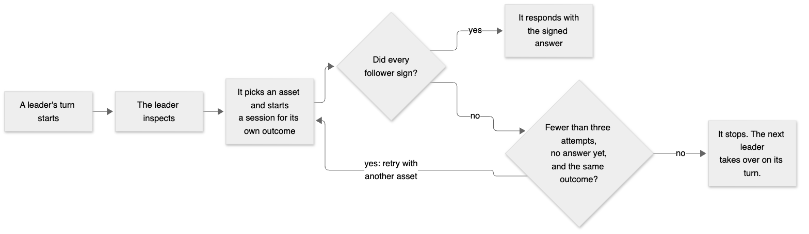

# Signed Negative and Inconclusive Outcomes for Foreign Transaction Verification

**Status:** Draft for discussion · **Author:** Haiyue Chen (with Claude) · **Date:** 28 September 2026, revised 18 November 2026

**Note on naming:** the new caller facing method is named `read_rpc`. For ease of comparing the new method to current V1 foreign transaction verification, this doc still calls it `verify_foreign_transaction_v2`.

## Summary

Today a foreign transaction request is signed only when the transaction checks out. Anything
else times out after the 200 block yield window, so a caller can't tell a failed transaction
from an MPC outage.

With this design, a V2 request gets one of three signed answers:

- **Verified:** the transaction checks out with the expected values.
- **Negative:** the transaction doesn't check out as requested. For example, it failed, was not
  found, its values differ from the expected ones, or it is not final enough yet. The answer
  doesn't say which. A later request can get a different answer, because the transaction may
  still land.
- **Inconclusive:** each honest signer found no conclusive outcome, because of provider errors,
  providers that disagree, or too few whitelisted providers with a conclusive result. It says nothing about the
  transaction, and the caller may try again.

If the network can't sign at all, or its nodes split between outcomes and no attempt signs, the
request still times out.

The main points of the design:

- Callers opt in through a new method, `read_rpc`. `verify_foreign_transaction` (V1) is unchanged.
- Every V2 answer names the one yield it answers, so on NEAR an old negative can never answer a
  newer request.
- Every V2 answer records the request's block height, and nodes sign only within 200 blocks of
  it.
- The caller states the values it expects. Nodes check them, so a verified answer confirms
  exactly those values.
- An honest leader signs only what it found, and an honest follower signs only if it found the same. So the
  signers of one session always agree on the message, with no extra round.
- Each leader makes up to three attempts, and backup leaders start on a fixed schedule.
- An inconclusive outcome at any node raises a warning, and so does every inconclusive a leader
  signs.

## Vocabulary

| Term | Meaning |
|---|---|
| Conclusive | Verified or negative. A provider result is conclusive or inconclusive. |
| Node outcome | What one node concludes from its providers: verified, negative, or inconclusive. |
| Answer | The signed outcome the caller gets: verified, negative, or inconclusive. |
| Session | One run of the threshold signing protocol, for one message with one asset. |
| Attempt | One session a leader starts for a request. |
| Leader | The node that starts an attempt. An honest node leads only from its turn on, and starts no attempt once an answer has landed. |
| Backup leader | A later node in the queue's failover order. It leads only if no answer has landed when its turn starts. |
| t, s, n | t is the signing threshold. Every asset has exactly t holders. s is the number of nodes that support the request's chain, and n the number of participants. |

---

## Architecture



1. **Request.** The caller calls `verify_foreign_transaction_v2` with the values it expects.
   The contract stores the request under a new yield id and announces the id in an event.
2. **Inspect.** Every node that can inspect the request (see "Node outcomes") does so once the
   request's block is final.
3. **Start.** The leader picks an asset and sends Start for its own outcome.
4. **Sign or abstain.** Each follower compares its own outcome with the session's.
   If they match, it sends its share. If not, it abstains.
5. **Respond.** The leader submits the yield id, the outcome and the signature. The contract
   checks the signature and resumes that yield.
6. **Failover.** If no answer has landed when the next leader's turn starts, that leader
   inspects again and makes its own attempts.

### Node outcomes

A node asks every provider it has configured, whitelisted or not, and maps each result to
verified, negative or inconclusive:

| Provider result | Maps to |
|---|---|
| Found, with values equal to the expected ones | verified |
| Found, with values that differ | negative |
| Failed, not found, log index out of bounds, account not found, block not canonical | negative |
| Not finalized, or fewer block confirmations than requested | negative |
| Transport errors, timeouts, a rejected call, a malformed or inconsistent response, a log not bound to its receipt | inconclusive |

A node retries transport errors within its inspection deadline, and a provider that hasn't
replied by then counts as a timeout. A rejected call is inconclusive, not negative, because a
misconfigured provider rejects calls too. Not finalized is negative, because the request states
its finality and the transaction doesn't meet it yet.

A node's outcome is conclusive when two conditions hold. Every provider with a conclusive
result, whitelisted or not, found the same one. The number of whitelisted providers among them is at least
the chain's quorum. Otherwise the outcome is inconclusive. An inconclusive provider result
counts toward neither condition. A node compares the mapped results, so two providers that report *not found*
and *failed* agree on negative.

A node can't inspect a request when it doesn't support the chain, has fewer whitelisted
providers configured than the chain's quorum, or can't convert the request. Such a node
abstains from every session, inconclusive ones included, by sending an abort, and makes no
attempt as a leader.

### Attempts

A session is bound to its request, its message and its asset. Each signer builds the message
from its own indexed request and its own outcome, so a request has exactly three possible
messages. A node joins only the session its Start names, so followers that got different
Starts never join the same session.

1. **Start.** The leader sends Start for a session for its own outcome.
2. **Followers check.** A follower first makes these checks, which need no provider call:
   - The follower has indexed the request. In its view, the request is open and its block is
     final. Open means not answered and at most 200 blocks old.
   - The sender supports the chain.
   - This Start is at most the sender's third to this follower for this request, counting every
     earlier Start whatever the follower replied. An honest leader stays within this cap,
     unless it restarts.
   - Every earlier Start from this sender for this request named the same outcome as this one.
   - The asset is the sender's, the Start lists exactly the asset's holders, and the follower
     holds its share of the asset.

   If one of these checks fails, the follower refuses. Otherwise it inspects again where "When
   nodes inspect" requires it, then compares its own node outcome with the session's. If they
   differ, the follower abstains. A follower that refuses or abstains sends an abort.
   Followers don't check whose turn it is.
3. **Result.** If every follower signs, the shares combine and the leader responds. If any
   follower abstains, refuses, stays silent or sends a bad share, the attempt fails. The
   leader then retries with another asset and the same outcome, up to three attempts in all.
   It stops earlier if an answer lands or its outcome changes (see "When nodes inspect").
   Resending a signed response that didn't land is not a new attempt.



In a split, nodes find different outcomes. Retries and
backup leaders pick other assets, and when few nodes differ, one of these attempts usually
signs.

Each attempt has a deadline, long enough for a follower to inspect and sign after Start
arrives. The implementation tunes this deadline, the inspection deadline, the maximum outcome
age and the two paging limits (see "Alerts").

A V2 request stays queued at every node until it is answered or times out, so every node can
still check Starts and see the answer.

#### When nodes inspect

A node inspects as soon as the request's block is final, because any node can become a
follower. Before finality, a fork could give the same yield id to another request.

- A node keeps one current outcome per request, from its latest inspection.
- A backup leader inspects again when its turn starts. Every leader inspects again before it
  uses an outcome older than the maximum outcome age.
- A follower uses its current outcome for every Start from the first sender it hears from for
  the request, in its turn or not, which saves a provider call. It inspects again on the first Start
  from each other sender. It also inspects again on any Start that arrives when its outcome is
  older than the maximum outcome age. It compares every Start, from any sender, with its current
  outcome.
- A leader keeps one outcome for all its attempts, because followers accept only one outcome
  from each sender. Before its first Start, a leader whose outcome changes uses the new one.
  After its first Start, a changed outcome means the leader starts no new attempt for this
  request, even when the change comes from an inspection it ran as a follower. An attempt
  already running finishes with the old outcome.
- A follower whose inspection still runs when Start arrives waits for the inspection. If the
  inspection doesn't finish before the attempt deadline, the follower abstains.

#### Picking assets

A leader only uses an asset whose holders all support the chain and have a recent view of
NEAR, so each has indexed the request by the time Start arrives.

Across requests, a leader records only which nodes replied to its recent Starts at all, with a
protocol message or an abort. The record never shows whether a node agreed, and the leader shares it with nobody. The
leader prefers assets whose holders all replied.

Within one request, and outside that record, a retry also prefers assets without the followers
that abstained, refused or stayed silent in the leader's earlier attempts. When no free asset meets both preferences,
the leader falls back to one that meets either, in an order the implementation picks. After
that, it takes any free asset the rule in the first paragraph allows.

#### Races between leaders

Turns follow a fixed schedule, so two leaders' attempts can overlap. Two leaders can then sign
different outcomes for one yield, for example a negative and then a verified outcome once the
transaction lands. The contract accepts the first response and rejects the other. We accept this race instead of adding a round to make leaders agree: each signed
outcome is what an honest node found.

### Alerts

An alert is a warning or a page. Verified and negative are expected answers and raise no alert.
An inconclusive outcome at any node most often points to a failing provider or an attack on the
cluster, for example on its provider connections. So a node raises a
warning, labelled with the cause, the chain and the providers, in two cases:

- its outcome is inconclusive, whether or not it leads or signs,
- as a leader, its inconclusive session gets a signature, whether or not its response lands.

The cause is the first of these that applies:

1. no provider has a conclusive result,
2. providers disagree,
3. too few whitelisted providers among those with a conclusive result.

On call gets a page when one of two rates passes its limit on one chain: the rate of V2 request
timeouts, or the rate of signed inconclusives whose leader's cause is 1 or 3. Cause 2 stays a warning,
because a caller can cause it with a mutable account or a transaction at the edge of its
finality. Timeouts still page, because a network that can't sign shows only as timeouts. A
caller can cause timeouts too, but only hurts its own requests.

Each follower counts its own abstains caused by a different outcome. The indexer counts responses that fail
with `RequestNotFound` after another response resumed the yield, labelled by whether the two
outcomes differ.

### How long a request takes

Leaving out any wait for an asset and the time for the response to land on NEAR:

- **The first attempt signs:** finality of the request's block, one inspection and one session.
- **A later attempt signs:** add at most one attempt deadline for each failed attempt, at most
  one failover interval for each backup leader's turn, and each inspection a leader repeats.

### Payload and response types

```rust
enum ForeignTxSignPayload {
    V1(ForeignTxSignPayloadV1),                    // unchanged
    V2(ForeignTxSignPayloadV2),
}

struct ForeignTxSignPayloadV2 {
    request: ForeignChainRpcRequest,
    expected_values_hash: Hash256,                 // sha256(borsh(expected_values)), length prefix included
    request_block_height: BlockHeight,             // the block that executed the request's receipt
    yield_id: YieldId,                             // the one yield this answers
    outcome: ForeignTxVerificationOutcome,
}

enum ForeignTxVerificationOutcome {
    Verified {},                                   // the values match the expected ones
    Negative {},                                   // the transaction doesn't check out as requested
    Inconclusive {},
}

struct YieldId([u8; 32]);                          // picked by the contract, see "Yield ids"
```

The payload hash is the sha256 of the Borsh encoded `ForeignTxSignPayload`, enum tag included.

- **A negative carries no reason.** Each node logs its reason.
- **The block height dates the answer.** A receiver outside NEAR sets the age it accepts, and
  measures it against its own source of NEAR's current block height.

```rust
struct VerifyForeignTransactionRequestV2 {
    request: ForeignChainRpcRequest,
    domain_id: DomainId,
    expected_values: Vec<ExtractedValue>,          // one per extractor, in extractor order
}

struct VerifyForeignTransactionResponseV2 {
    payload_hash: Hash256,
    signature: SignatureResponse,
    request_block_height: BlockHeight,
    yield_id: YieldId,
    outcome: ForeignTxVerificationOutcome,
}
```

- **The contract stores only a hash of the expected values,** because the values have no size
  cap. Nodes read the values from the request's receipt.
- **The contract rejects malformed requests:** a wrong number of expected values for the
  extractors, or a field outside its chain's range, such as a Starknet id that isn't a field
  element.
- **No expected payload hash, unlike V1.** The yield id takes over the replay protection, and
  the caller can't compute the payload hash in advance, because the contract sets the block
  height when the request arrives.
- **A receiver outside NEAR checks the signature itself.** It takes the request and the
  expected values from its own records, and the yield id, block
  height and outcome from the response. It computes the expected values hash, rebuilds
  `ForeignTxSignPayload::V2` and verifies the signature with the domain's root public key, with
  no tweak. It also rejects an answer whose yield id it has already used. It can't tell an
  answer to its own request from an answer to an identical copy (see "Replay and reuse"). We extend the
  SDK's signature verifier to V2, and document the steps for callers who don't use it.

### Yields and the respond method

In V1, one signed response answers every pending request with the same arguments, which is
wrong for a negative once the transaction lands. A V2 signature names a single yield, and nodes
queue identical requests separately by receipt id.

#### Yield ids

The contract picks each yield id itself, so the yield callback can carry it.
`promise_yield_create` can't do that: it creates the id after the callback's arguments are
fixed.

The contract keeps a `u64` counter that every successful V2 request increases and that
survives every migration. For each V2 request it:

1. hashes the next counter value into an id,
   `sha256("verify_foreign_tx_v2" || counter.to_le_bytes())`,
2. creates the yield under that id with `promise_yield_create_with_id`, with the id in the
   callback's arguments,
3. stores the request, the hash of its expected values and the current block height under
   the id.

The prefix keeps V2 ids apart from ids the contract may pick for other yields later. A fresh
counter value can't collide. If the create call ever returns `None`, the contract fails the
request.

`promise_yield_create_with_id` and `promise_yield_resume_with_yield_id` need NEAR protocol
version 85 or later. Ids are hex encoded in the event and the response.

#### How nodes learn the id

The call's result arrives only with the answer, so nodes can't learn the id from it. The
contract emits the id in the same call as a
[NEP 297](https://github.com/near/NEPs/blob/master/neps/nep-0297.md) event:

```text
EVENT_JSON:{"standard":"mpc","version":"1.0.0","event":"verify_foreign_tx_v2_yield_created","data":{"yield_id":"…"}}
```

- The indexer reads the event only from a `verify_foreign_transaction_v2` receipt that
  succeeded. A failed receipt keeps its logs but rolls back the counter, so a later request
  gets the same id.
- The indexer reads only log entries that start with `EVENT_JSON:`, carry the `mpc` standard and
  name `verify_foreign_tx_v2_yield_created`. It stores the yield id with the request, and skips
  a request with no such event, or several.

#### The respond method

Attested participants answer through a new respond method:

```rust
fn respond_verify_foreign_tx_v2(
    yield_id: YieldId,
    outcome: ForeignTxVerificationOutcome,
    signature: SignatureResponse,
)
```

This method:

1. Makes the same checks as V1's respond method.
2. Looks up the request stored under `yield_id`, and fails with `RequestNotFound` if there is
   none.
3. Rebuilds the payload hash from the stored request, expected values hash and block height,
   the yield id and the outcome.
4. Verifies the signature with the key of the request's `domain_id`.
5. Resumes that yield through `promise_yield_resume_with_yield_id` with a
   `VerifyForeignTransactionResponseV2`, and removes the entry. If the resume fails, the call
   fails and nothing changes.

The V2 yield callback, the counterpart of V1's
`return_verify_foreign_tx_and_clean_state_on_success`, runs on the answer and on the timeout.
On a timeout, it removes only the entry stored under its own yield id. An answer has landed,
and nodes see the request as answered, when the callback runs on the answer.

---

## Q&A

### Why a new request method?

V1 must not change, so V2 has to be opt in.

- **A. Extend V1 in place.** It changes every V1 payload hash.
- **B. A `payload_version` flag on the existing method.** It needs a hand written deserializer
  and breaks existing V1 callers.
- **C. A new method with its own request type (chosen).**

### Why does each leader sign only its own outcome?

Nodes can find different outcomes, but every signer in a session must sign the same message.

- **A. Bind the session to the request only, as V1 does.** Followers that found different outcomes would
  sign different messages in one session.
- **B. Collect outcomes from every node first, then sign with an asset among the nodes that
  agree.** Every answer costs one more round, and nodes need keys registered with the contract
  to check the outcomes the leader relays.
- **C. Sign only verified answers with the threshold key, and answer the rest with the nodes'
  own signatures.** It puts much more data on chain, and a receiver must check many node keys
  instead of one MPC key.
- **D. The leader starts a session for its own outcome only, and followers join only on a
  match (chosen).**

D's cost is that a split in which no attempt signs ends in a timeout (see "Why is a split between nodes never signed as inconclusive?").

### Why is a split between nodes never signed as inconclusive?

To sign an inconclusive when nodes found different outcomes, followers with a conclusive
outcome would have to accept proof that others disagree.

- **A. Followers that abstain send signed node outcomes, and the leader shows these as
  evidence.** It needs a key per node registered with the contract. Simple evidence rules
  ("two nodes differ") let one malicious node force an inconclusive. The safe rule needs, for
  each conclusive outcome, s − t + 1 nodes that didn't find it. That is option B of "Why does
  each leader sign only its own outcome?" again.
- **B. Every node sends its outcome to all others, and each node signs the inconclusive when
  it sees that no conclusive outcome can reach t.** Each node hears every outcome directly, so it needs no
  node keys, but it adds a message from every node for every inspection.
- **C. No signed inconclusive for splits (chosen).**

We expect splits to be rare, and when few nodes differ an attempt usually signs (see
"Attempts"). A timeout tells the caller the same as an inconclusive: try again later. A or B can be
added later if the abstain metric (see "Alerts") shows that splits are common.

### How many attempts does a leader make?

Three, from a simulation with s = 17, t = 11 and four leaders.

With one attempt per leader, one node that stays silent or always abstains makes 17% of
requests time out. With three attempts per leader, two such nodes cause no timeouts and three
cause 0.2%. Four honest leaders use at most twelve assets per request. Starts sent out of turn
can add more.

A bad share doesn't show its sender, so retries can't leave the sender out. Even with three
attempts, two nodes that send bad shares make a quarter of requests time out. Only tracing bad
shares to their senders closes that gap.

### How does V2 roll out?

No upgrade order breaks V1 callers.

- **P2P needs one protocol version bump**, for the V2 signing session as a new task kind whose
  id names the outcome. Aborts reuse the existing message.
- **The V2 method ships in its own contract release**, once every node supports V2. Old nodes
  would ignore V2 requests, which would then time out. The release also needs NEAR protocol
  version 85 or later (see "Yield ids").

---

## Security analysis

We assume, as V1 does, that fewer than t nodes are malicious. A signature then proves that at
least one honest node found that outcome, not that t nodes did.

### Leaders and followers

| Threat | Defense |
| --- | --- |
| Malicious leader forges a conclusive outcome | Every honest follower runs its own inspection and joins only a session for its own outcome, so at least one honest holder found that outcome. |
| Malicious leader forces an inconclusive | Honest followers join an inconclusive session only when their own outcome is inconclusive, and a node that can't inspect abstains. |
| Malicious leader picks among honest outcomes | Not prevented. An asset's owner picks its holders. When the leader and t − 2 other holders are malicious, one honest follower that agrees is enough. So while honest nodes differ, for example because one has a lagging provider, the leader can get the minority outcome signed. Each honest node still found what it signed. |
| Leader asks to sign for a request that doesn't exist | Honest nodes only sign for requests their own indexer has seen. |
| Leader reruns an answered or timed out request | Honest nodes refuse to join once their indexer shows the request answered or older than 200 blocks. |
| Malicious node uses up assets with Starts, in its turn or out of it | A follower refuses every Start after a sender's third for a request. Every holder counts Starts, whether or not it supports the chain. Each Start goes to t − 1 followers, so at most 3(n − 1)/(t − 1) Starts from one sender fit within the cap per request. A Start uses up the sender's asset whether or not followers join. Followers refuse Starts beyond the cap without a provider call, so those cost only the sender. A Start within the cap costs each follower at most one inspection. |
| Malicious node shifts who leads, for example by overstating its indexer height | Not new. V2 uses the queue's leader rule unchanged, and followers don't check whose turn it is. |
| Followers of one session sign different messages | A session is bound to its request, message and asset, lists exactly the asset's holders, and only followers with the same Start join it (see "Attempts"). |
| Follower abstains, refuses, stays silent or sends a bad share | Liveness only. The attempt fails and the leader retries with another asset (see "Picking assets"). A node that sends bad shares can't be left out (see "How many attempts does a leader make?"). |

### Providers

| Threat | Defense |
| --- | --- |
| Honest nodes find different reasons for one negative | A negative carries no reason or provider data, so honest nodes sign the same bytes. |
| Faulty provider drives a conclusive outcome | A node reaches a conclusive outcome only with the chain's quorum of whitelisted providers and no provider that disagrees (see "Node outcomes"). So faulty providers drive one only if, at every honest holder of an asset, they reach that quorum while every other provider there is inconclusive. V1 has the same limit. Otherwise a provider that lies to every node only makes those nodes inconclusive. |

### Replay and reuse

| Threat | Defense |
| --- | --- |
| V2 answer passed off as a `sign()` or V1 signature, or the other way round | Foreign transaction domains have their own key, and the contract checks a domain's purpose. Foreign transaction signatures use no tweak, and the payload's enum tag separates V1 from V2. |
| Old negative replayed after the transaction lands | On NEAR each signature is tied to one request, which is closed once it is answered. A new request gets its own inspection. |
| Signature replayed on another caller's request | On NEAR the contract only answers the yield the signature names. Outside NEAR the receiver verifies over its own request and expected values and rejects reused yield ids, but an answer to another caller's identical request passes (see the row "Caller resubmits copies of a request until one gets a malicious leader"). |
| Old negative relayed off NEAR later | The signature carries the request's block height, and honest nodes only sign within 200 blocks of it, so the receiver can bound when the network inspected the transaction. |
| Two different outcomes signed for one yield | The contract accepts the first response and rejects the other (see "Races between leaders"). The rejected signature stays public on chain, which is safe: each signed outcome is what an honest node found at the time. |
| Someone gets a negative for a transaction that does or will check out | Not prevented. Anyone can get one by asking before the transaction lands or by stating wrong values. A receiver must build the payload from its own expected values (see "Payload and response types"), and never treat a negative as proof that the transaction won't land. |

### Callers, contract and node state

| Threat | Defense |
| --- | --- |
| Caller plants a fake yield id | Nodes read the id only from the `mpc` event of a `verify_foreign_transaction_v2` receipt that succeeded. Only the contract's code writes that event, and it writes only the id it generated. |
| Caller predicts or picks the leaders | Not new. The leader order follows from the request's receipt id, never from the yield id, which anyone can predict from the counter. |
| Caller resubmits copies of a request until one gets a malicious leader | Not prevented outside NEAR. On NEAR the copy's answer names the copy's yield id and answers only the copy. Outside NEAR it looks like an answer to the original, with the outcome that leader picked (see the row "Malicious leader picks among honest outcomes"). |
| Caller causes inconclusives | The contract rejects malformed requests, such as an out of range field that every provider would reject. A caller can still make providers disagree, which costs the caller a request like any other. That cause stays a warning (see "Alerts"). |
| Caller floods requests | Every node that supports the chain inspects each request, where V1 only has an asset's t holders inspect. Every attempt uses an asset, even for a negative. Provider quotas are shared with V1. We accept that as the cost of signing every answer. |
| Receiver trusts the outcome label without checking the signature | On NEAR the contract checked the signature over the caller's own expected values hash, so the label is safe to trust. Outside NEAR the receiver must check the signature (see "Payload and response types"). |
| Responder submits a signature with a different outcome | The contract rebuilds the payload hash from the submitted outcome, and rejects the response if the signature doesn't match. |
| Late timeout removes an open request | Each request is stored under its own yield id, and a timeout only removes its own entry. |
| Node restarts or reshares during a request | Queue state, current outcomes and Start records live in memory. A restart loses them, and so does a finished resharing, which restarts each node's signing job. As in V1, the node refuses Starts for a request it indexed earlier unless its indexer processes that request again. That request can then time out. A request it indexes again starts with empty Start records, so a sender can exceed the cap there. That costs assets, not safety. |
